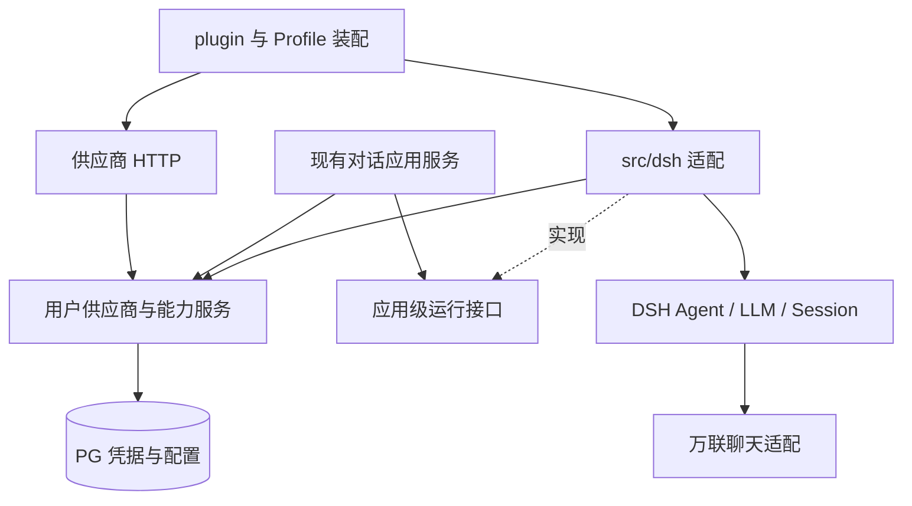

# 万联供应商完整接入 PRD

本页维护 W1 用户配置/动态目录与 W2 文本接入的需求、安排和判据，稳定身份及原成果键保留。用户已于 2026-11-10 接受本期 W1/W2 的模型扩展与默认文本闭环，实际范围和限制见[原成果入口](complete/report.md)，不在此复制动态进度。Claude/Messages 进一步适配和真实验收仍为后续条件项，旧未验/失败及确定性回归保留。D1/D2 原接受见[对话成果入口](../conversation-service/complete/report.md)，本次拆分不重开或改写任何旧接受。返回[任务资料与成果](../index.md)。

## 1. 目标、范围与完成含义

本页目标是在当前 TypeScript Mio 服务中接入 OneLinkAI（万联，供应商类型 `onelink`）用户配置、动态模型目录和可信文本调用：请求、凭据及收费副作用归属于本人。DSH 提供 Agent 和 Session，Mio 承担供应商业务与对外服务，不维护第二套 Agent 循环。

本期 W1/W2 覆盖动态目录、模型扩展、默认文本闭环及相应隔离/恢复。本期接受不表示全部型号、Messages 后续项或全部万联业务完成。旧界面、Python 类结构和历史兜底实现不作为必须复制的目标。

原 W3–W7 现为[图片](../onelink-image-generation/prd.md)、[视频](../onelink-video-generation/prd.md)、[音频](../onelink-audio-generation/prd.md)、[素材库](../onelink-material-library/prd.md)和条件性 [Agent 工具](../onelink-agent-tools/prd.md)五份独立需求，各自安排和接受，不形成主从 PRD 或总完成门禁。共享任务/资产候选归[独立设计](../onelink-image-generation/design.md)，由首个真实消费者承担。拆分不启动媒体业务、不预建执行记录、不迁移旧 result，也不扩大非文本费用或工具授权。

正式前端、项目/剧本/分镜全业务、组织多租户、平台代付与充值计费、供应商市场、多地域部署及生产容量承诺不在本页范围。必要隔离文本验证沿本人 Key 与既有授权；不提交推送发布、不迁移共享/生产库。BYOK 不代表可不经用户动作自动生成，也不代表 Mio 能准确推算供应商余额。

## 2. 当前架构与需要改变的接缝

初次动态目录改造的历史基线为 Mio `681f7f05a1061ed1a8e5d55453cf49c8ca8261fb`、DSH `0.2.2-rc.1`，当时已有未提交 W1/W2 产物，HEAD 不代表当时完整候选。下表仅保留改造前接缝，不描述当前仍缺失这些实现。本轮沿已有动态目录与协议适配核验扩展，当前源码、验证和接受按原 W1/W2 记录核对。

| 对象         | 改造前事实                                                                                                                                              | 本方案如何承接                                                                                    |
| ------------ | ------------------------------------------------------------------------------------------------------------------------------------------------------- | ------------------------------------------------------------------------------------------------- |
| 认证         | 已有邮箱账号、持久登录及可信 `Authentication.identity`；接受范围见[认证成果](../ai-drama-foundation/complete/report.md)                                 | 复用身份解析；供应商、任务、素材等各自检查 owner，服务 token 不能代替用户                         |
| 对话服务     | [对话规范](../../conversations.md)与[HTTP契约](../../apis/conversations.md)已有本地候选；两协议代表有真实观察，接受仍待各任务核对                       | 复用owner、busy、去重、历史/SSE、取消/恢复，不重建API和消息库                                     |
| 模型选择     | [供应商服务](../../../src/providers/service.ts)和[目录](../../../src/providers/catalog.ts)仍用静态名单决定显式选择、默认与偏好；现有 modelRef 含分类    | 新版 W1/W2 改用当前凭据的动态目录准入及稳定身份，保留旧引用解析、一次绑定和去重顺序               |
| 目录与持久化 | [schema](../../../src/providers/schema.ts)目前仅 configs/preferences 两表，单个 discovery 保存最近一次观察；失败覆盖旧发现，缺同版本刷新乱序防护        | 分离最近成功快照与刷新尝试，新增 models/adaptations，完整响应原子发布；现有旧凭据写回防护继续保留 |
| DSH 模型入口 | [OneLink 适配](../../../src/dsh/onelink.ts)的 metadata/listModels/resolve/prepare 链仍依赖静态目录，公开 listModels 没有 owner 参数                     | 用户目录由 Mio 提供；请求作用域消费冻结事实，不能将各用户目录合并成全局可用名单                   |
| DSH 装配     | [Profile](../../../cordis.patch.yml)显式装载 Agent/Loop/Session/JSONL；当前无 provider 域保留显式 deepseek-official，启用后由 Mio 注册 OneLink 文本路由 | 保留最小 Profile、固定版本与公开 LLM 接口；BYOK 缺本人配置不回退，不加载默认 Web/SDK 大 Bundle    |
| 内容和元数据 | DSH 日志是对话正文权威，PG 保存归属/接收元数据；跨存储无原子提交                                                                                        | 路由身份进入 Mio 元数据；Key 不进 Session。生成任务/资产另有事实表，不双写对话正文                |
| 工具权限     | 根及 Agent 作用域均拒绝工具，[DSH 契约](../../integrations/dsh.md)要求拒绝不可被后注册 allow 覆盖                                                       | W1–W6 保持拒绝。W7 必须显式替换适用守卫策略并验证实际执行链                                       |
| 存储         | [PostgreSQL](../../integrations/postgres.md)已有按域持有池与显式迁移；[Redis](../../integrations/redis.md)目前只供认证限流                              | 新业务沿用资源责任，不借认证内部池；默认不新增 Redis 队列或缓存                                   |
| 媒体与任务   | 尚无生成任务、资产、上传和素材库业务                                                                                                                    | 从各独立 PRD 与共享候选设计进入，不把旧项目服务视为已经存在                                       |

本 PRD 基于现有对话实现扩展供应商。W2 已采用本人 modelRef/默认及旧会话一次绑定，现行行为见[对话规范](../../conversations.md)和[HTTP](../../apis/conversations.md)。D1/D2 已接受，本轮在 W1/W2 候选核验受影响的内核、身份、持久化与对话回归，不重新安排 D1/D2 接受，也不将旧原件改绑到新候选。

本轮 W1/W2 已同步[供应商规范](../../providers.md)、[供应商 HTTP](../../apis/providers.md)、[万联集成](../../integrations/onelink.md)、[对话规范](../../conversations.md)、[对话 HTTP](../../apis/conversations.md)和[DSH 契约](../../integrations/dsh.md)：动态目录为成员权威，四表保存独立事实，fresh 准入冻结目录/适配版本；规范和实现进入同一候选重新验证，不继承旧静态名单证据。

## 3. 旧版能力基线与迁移覆盖

旧版调查来源是用户指定的 Mio v1.5 源码，历史核对日期为 2026-11-09；该检出没有可用 HEAD，不以目录名或代码注释中的历史实测声称线上可用。下表仅作能力迁移参考，公共构建、测试和部署不依赖本机相邻旧目录。需要保留的脱敏协议样例/旧快照应置于非生产迁移参考或测试资料，记录来源身份；`src/providers/legacy-snapshot.ts` 必须退出生产运行链路与构建覆盖，而不只是删除一个 import 后继续打包。

| 需求        | 能力与旧源码定位（相对旧仓库 `backend/app/`）                                                          | 协议与迁移要求                                                                                                     | 开发单元                   |
| ----------- | ------------------------------------------------------------------------------------------------------ | ------------------------------------------------------------------------------------------------------------------ | -------------------------- |
| WL-01       | `routers/providers.py::oneclick_setup`、`services/user_api_key.py`、`models/provider.py`               | 用户凭据、启停、连接测试、默认水印、模型默认项；加密保存和脱敏返回                                                 | W1                         |
| WL-02       | `services/onelink_presets.py`、`services/model_capabilities.py`、`services/model_capability_policy.py` | 旧 ID/分类/参数与偏好仅供迁移核对；当前用户 Key 动态返回决定成员，协议/能力独立适配，不迁移静态白名单              | W1，后续各能力补齐参数验收 |
| WL-03       | `services/llm.py`                                                                                      | 旧聊天使用 `/v1/chat/completions` 与 `/v1/messages`；新实现按可靠声明关联协议，不按 Claude/s-claude 等名称前缀推断 | W2                         |
| WL-04       | [图片需求](../onelink-image-generation/prd.md#1-结果与范围)                                            | 图片协议与操作迁移明细在该独立需求维护                                                                             | W3                         |
| WL-05/06/07 | [视频需求](../onelink-video-generation/prd.md#1-结果与范围)                                            | 视频协议、模式与下载差异在该独立需求维护                                                                           | W4                         |
| WL-08/09    | [音频需求](../onelink-audio-generation/prd.md#1-结果与范围)                                            | 配音、音色、音乐/歌词/翻唱在该独立需求维护                                                                         | W5                         |
| WL-10       | [素材需求](../onelink-material-library/prd.md#1-结果与范围)                                            | 认证、素材管理与生成联动在该独立需求维护                                                                           | W6                         |
| WL-11       | [共享候选设计](../onelink-image-generation/design.md)                                                  | 任务身份、恢复和受管资产的共同候选                                                                                 | W3–W6                      |
| WL-12       | `utils/onelink_base_url.py`、`services/onelink_error_mapper.py`、`services/http_client.py`             | 文本现行行为沿[万联契约](../../integrations/onelink.md)；非文本候选与旧回退取舍见共享设计                          | W1/W2 与独立媒体需求       |

旧预置表有 92 条：chat 55、image 11、video 22、voice 2、music 2。该数量仅是迁移参考，不再作为运行目录完整性、可选择或可调用的判据。当前用户 Key 的接口动态返回集合是成员唯一权威；`src/providers/catalog.ts` 不再构造静态模型白名单，不能将旧名单搬成 JSON、数据库 seed 或其他生产依赖继续限制新增模型。新增供应商模型无需修改生产模型名单或重新发版即可展示；复用已实现协议时，经可靠元数据或受控适配关联即可调用。

历史模型引用、用户偏好和旧能力差异逐项保留迁移处置；当前目录未包含的历史型号只标本账户当前不可用，不能凭缺项断言供应商永久下线，也不能用旧预设补成成员。发现、适配已实现、真实调用已验证分别记录，代表模型不证明全部别名/高级功能。媒体与素材的完整目标和未验项由各独立 PRD 保留，不因拆分或旧型号缺失删减。

## 4. DSH 与 Mio 的职责方案

| 能力                             | 复用对象                                          | Mio 增量及边界                                                                            |
| -------------------------------- | ------------------------------------------------- | ----------------------------------------------------------------------------------------- |
| Agent 执行、多轮上下文、消息结算 | DSH Agent/Loop/System Prompt                      | 只提供可信运行配置和业务工具入口；不复制 loop、inbox 或上下文管理                         |
| Session 持久化/恢复/取消         | 当前 MioKernel + 官方 JSONL/Query/flush           | 保留现行对话回执与中断语义，处理路由绑定和用户归属，不把生成任务塞进 Session 作为唯一事实 |
| LLM 消息与流                     | `dsh-llm` 的 LlmAdapter、prepareCall、StreamChunk | 万联逻辑路由、模型能力、凭据绑定、协议差异和错误投影                                      |
| 通用聊天协议编码                 | 优先验证固定版 `dsh-llm-pi-ai` 的公开 PiAiAdapter | 能满足 BYOK 和万联 wire 行为就复用；不足时仅实现有证据的专用协议适配，仍接同一 LLM seam   |
| 账号与 API 身份                  | 当前认证及 HTTP 响应原语                          | provider 与对话的 owner/授权；不复用 DSH 本机设置页作为 SaaS 账号配置                     |
| 供应商配置和目录                 | 既有 W1 加密存取、owner 与偏好服务                | Mio 改造动态目录、独立适配和用户偏好；保留凭据版本及隔离，不修改进程环境变量切换用户      |

文本侧依赖如下；媒体/任务候选职责直接见[共享设计](../onelink-image-generation/design.md#1-现行依赖与采用边界)，工具职责见其独立 PRD。

`src/providers/` 保存凭据/目录/运行解析，`src/integrations/onelink/` 保存现行网关客户端，`src/dsh/` 保存 DSH 桥接。普通业务只依赖不含 DSH 类型的接口，不能从 `src/conversations/` 直接导入框架。模块导入、类型与构建覆盖按实际消费者维护，不扩大成全部 src 可任意导入。

### 4.1 聊天适配选择与用户隔离

内部可用 `onelink-openai`、`onelink-anthropic` 两个协议路由表达同一个逻辑供应商，模型 ID 原样保留，不能根据展示名删去 s-、线路后缀或强制大小写归一。当前 DeepSeek 官方适配不能代表万联中转的 DeepSeek/其他模型。

固定版本源码确认 PiAiAdapter 可公开导出，支持自定义 OpenAI/Anthropic 路由；但 `resolveApiKey(provider, profile)` 不接收 Mio 用户身份，单个全局 profile 加 apiKeyEnv 并不能完成本需求。W2 先验证公开构造/配置入口、必要 peer 依赖和无环境凭据回退，再选择最小实现：由 Mio 在已授权运行中绑定不可变供应商/凭据快照，通过作用域适配或受控包装委托通用编码。只读模型元数据准备不得解密任意用户凭据。

一次新模型请求须在准入时冻结用户、conversationId、内部 dshSessionId、requestId、providerConfigId、稳定模型身份与原始 modelId、credentialVersion、catalogVersion、适配声明版本和 operation/profile；只有服务端 owner 查询产生该绑定。凭据密文只在受控边界解密为该请求内存快照，不写入回执或 Session。若通过 sessionId 查询绑定，缺失/过期/不匹配就拒绝。并发调用不能改共享实例的当前 Key、profile、headers 或 process.env；辅助调用没有可信绑定也拒绝。metadata、resolve、prepare 和 dispatch 必须消费同一次绑定，刷新不改变在途模型或版本。

DSH 的全局 `listModels(provider)` 没有 owner 参数，不承担用户目录发现与授权，不能返回各用户目录的并集、首个用户或上次请求的名单。用户模型列表由 Mio 认证入口返回；无可信用户/请求作用域的 DSH 模型入口不得解密凭据或授予调用资格，必要时返回空列表或明确不可解析。新版 W2 须在固定公开接口内落实请求作用域元数据路径，清除 `src/dsh/onelink.ts` 的 metadata/listModels/resolveModel/prepareCall 及其间接静态依赖，不改上游、不复制 Pi 编码或 Agent/Session/持久化。

旧 Claude 适配会过滤 tool 角色、丢弃 thinking/tool_use，只适合其原文本出口，不能原样迁移成 Agent 适配。新适配在 DSH 内部保留受支持的文本、工具调用/结果、usage、结束原因及必要 replay 信息，正确传递 AbortSignal，并按公开接口加入 attributionHeaders；公开历史和 SSE 仍按当前白名单隐藏推理与内部工具数据。工具协议测试使用隔离无副作用夹具，生产守卫继续拒绝。还须核验旧万联 Bearer 鉴权与通用 Anthropic 请求头的差异，不能从接口路径相同推导兼容。模型上下文/输出上限、结构化输出与推理选项采用核实后的能力值，不能直接采用未知模型的 SDK 大容量默认值；不支持的请求在出站前明确拒绝。

### 4.2 用户配置、模型选择和凭据生命周期

用户自行配置 Key；每用户一个逻辑 onelink 配置，不存在平台或其他用户 Key 兜底。网关固定 `https://api.onelinkai.cloud`，用户不能提交任意 URL、认证头或代理。凭据继续使用部署显式注入的独立主密钥及 AES-256-GCM，AAD 绑定 owner/配置/凭据版本/主密钥 ID；保护与恢复沿[现行规范](../../providers.md)。本次调整目录持久化与资格，不引入管理员角色、供应商市场或通用规则平台。

#### 4.2.1 目录事实、适配声明与用户偏好

- **目录事实**：仅当前配置、当前 Key 的完整成功响应建立成员。原始模型 ID 保留大小写、标点及线路后缀；稳定模型身份由配置与精确原始 ID 确定，不包含分类、协议或适配状态。分类后补、适配变化及同 ID 再次发现均更新同一实体。缺元数据使用 null/unknown，未知分类不默认为 chat。
- **适配声明**：官方[模型列表文档](https://docs.onelinkai.cloud/8882392m0)没有承诺 `/v1/models` 逐模型完整协议/能力；[文本协议文档](https://docs.onelinkai.cloud/8882612m0)列出的协议也不是每个模型都支持这些协议的保证。只有足够可靠、可追溯的结构化元数据才自动关联已有 operation/profile；名称前缀、展示名和自由描述不足以判定协议，未知模型不能统一兜底 OpenAI。上下文、价格、工具、媒体及参数能力未知就保留未知，不能用 SDK 默认值或旧快照补造。
- **受控维护**：元数据不足的模型仍立即在用户目录展示为待适配。部署侧的受控配置导入/更新入口只可定位本配置中已发现的模型，为其选择服务端已实现的 operation/profile，并保存声明来源、来源版本和独立适配版本；不得创造成员、上传执行代码、配置任意网关或把人工声明写成已验证。人工补充的协议/能力信息明确标为人工声明及依据，可信程度和未验证项如实展示；无支持依据时不宣称能力。普通用户只管理启停/默认偏好。配置格式和路径在 W1 C0 定稿，沿已有部署职责，不新建通用后台。
- **资格与验证**：目录成员、协议实现状态、适配声明及真实验证状态分别返回。当前成员、同凭据有效快照、配置/用途启用及已实现适配共同决定新请求资格；真实验证只由对应实际观察登记，不能由配置开关伪造。适配已实现且未实测的项可以在授权下调用以取得观察，但不得展示为“已验证”。默认项按业务用途约束，未知分类不产生 chat 默认，测试默认不替用户设默认。

#### 模型增长时的扩展方式

后续显式回扫成功后，新模型立即进入当前用户目录；发现、已实现适配、真实验证分别记录。扫描不自动生成或设置默认，也不按名称猜协议。

| 变化                       | 最小扩展与验证                                                                                                                                  |
| -------------------------- | ----------------------------------------------------------------------------------------------------------------------------------------------- |
| 新 ID 完全兼容已有 profile | 通过可靠结构化元数据或有依据的受控声明关联已有 operation/profile，复用调用链；无需新增生产型号名单或重新发布，核对精确出站 ID、协议及请求版本。 |
| 同协议的参数或返回语义不同 | 依据文档或实际失败样本，在适配层补最小差异和能力校验，复用身份、会话、流、取消及持久化；不以任意参数透传宣称兼容。                              |
| 新协议或操作               | 增加有实际消费者的实现，同步类型/声明准入、必要存储约束、固定目标/传输政策及新旧路径回归；未知 profile 明确拒绝，不能进入 OpenAI 默认分支。     |

当前只保留两种已实现文本 profile，集中维护路由、公开 codec、端点和已核实兼容项；不预建每型号一个类、通用 DSL、代码上传或后台试调平台。稳定身份不包含 profile，扩展不重建业务会话或消息库。使用启动后回扫新增多个未知 ID（含大小写差异、后缀及误导性名称），经声明进入正式用户 API/DSH 链的测试证明已有协议复用；未适配项可见且无出站。新协议仍需代码与回归，配置不能创造未实现能力。

#### 4.2.2 持久化字段与约束

沿用所属业务的 PG 池与显式迁移，保留并调整 configs/preferences，新增 models/adaptations。下列是本期迁移必须表达的字段和约束，SQL 类型/可逆命名由 W1 C0 结合现有 schema 定稿；不能只建四个空概念，也不新增跨库外键。

| 表                               | 必需字段与约束                                                                                                                                                                                                                                                                                                                                                                                                                                                                                                                                                                                                                 |
| -------------------------------- | ------------------------------------------------------------------------------------------------------------------------------------------------------------------------------------------------------------------------------------------------------------------------------------------------------------------------------------------------------------------------------------------------------------------------------------------------------------------------------------------------------------------------------------------------------------------------------------------------------------------------------ |
| `mio_provider_configs`           | 保留 `id/owner/enabled/revision`、水印、加密格式/密文及 `credential_version/master_key_id`；owner 的 onelink 配置唯一。分别保存 `catalog_version/catalog_credential_version/catalog_succeeded_at`（尚无任何成功时均为空；成功空目录也有版本/时间）、递增 `latest_refresh_seq`、`last_attempt_seq/last_attempt_credential_version/last_attempt_started_at/last_attempt_finished_at/last_attempt_status/last_attempt_error_code`，以及当前凭据 `credential_auth_state`（unchecked/valid/rejected）。轮换后旧成功版本可保留为历史，但与当前凭据不匹配即无当前快照；错误仅脱敏码，失败不覆盖成功快照；版本和序号为受约束的递增值。 |
| `mio_provider_models`            | `model_key` 为稳定主键；`provider_config_id/raw_model_id` 精确、区分大小写唯一，外键指向本配置。保存受限且脱敏的 `supplier_metadata`、可空分类及元数据来源、`credential_version/catalog_version`、`first_seen_at/last_seen_at`、`membership_state`（current/removed/historical）。仅历史引用且从未有效发现的行没有发现时间/快照版本；不能伪填。当前成员必须属于本配置当前凭据及成功快照，移除或轮换保留实体；同 ID 再出现复用 model_key。                                                                                                                                                                                      |
| `mio_provider_model_adaptations` | `provider_config_id/model_key/operation` 唯一，复合归属外键不能关联其他配置；只能为有有效发现来源的条目建立适配，写入时核对当前成员。保存受服务端注册表约束的 `profile`、`declaration_version/source/source_version`、可空且有来源的能力声明、`verification_status/verified_at/evidence_ref` 及受验凭据/目录/适配版本。更新声明使相关验证待重新核对；历史记录/引用保留，配置导入不能设置 verified。实现状态由实际服务端代码能力决定。                                                                                                                                                                                          |
| `mio_provider_model_preferences` | 以 `provider_config_id/model_key/usage` 唯一保存 `enabled/is_default/updated_at`；usage 是服务定义的业务用途，不是分类或协议，也不改变模型身份。每配置/usage 至多一个默认，用部分唯一索引保证；设置默认在同一事务核对成员、适配用途和启用状态。未知分类保持可空且不自动生成 chat 用途偏好。移除/轮换/停用时保留偏好行及原默认目标，返回默认失效原因，不自动另选模型；有效性按当前资格判断。                                                                                                                                                                                                                                    |

配置、模型、适配和偏好查询始终带可信 owner/config 条件；复合外键及唯一约束支撑跨用户隔离。当前目录/适配/偏好与凭据在同一一致读取中冻结，不能分别读出不同时点的资格再拼装。对话 PG 可与供应商 PG 分离，按现有跨存储回执规则持久脱敏版本绑定，不承诺跨库原子提交。

#### 4.2.3 显式刷新、失效和请求冻结

刷新由用户显式动作触发，复用/调整当前目录测试入口，不在保存、读取、启动或每次调用时自动访问供应商。开始时持久分配本配置递增刷新序号并绑定 credentialVersion；完整校验响应结构、精确 ID、数量/体积、元数据及完整性后，在一个事务中发布新的成功快照、成员增删状态与相关默认有效性。不得先写半份列表或把格式错误当成功空目录。重复精确 ID 的冲突元数据不能任意择一冒充完整成功。

| 结果/变化                          | 目录与新请求行为                                                                                                                                                                               |
| ---------------------------------- | ---------------------------------------------------------------------------------------------------------------------------------------------------------------------------------------------- |
| 当前凭据从未成功                   | 无当前可用快照；新模型选择/调用拒绝，展示尚未取得目录。历史行不补成当前成员。                                                                                                                  |
| 成功空目录                         | 记录成功时间与新目录版本、当前成员数 0，旧成员移除、默认失效；不能等同网络失败或回退旧目录。                                                                                                   |
| 超时、限流、上游临时失败或非法响应 | 只更新最近尝试/脱敏错误；保留同凭据版本的最近成功快照，明确成功时间、stale 和失败原因，允许其中仍启用且已适配项继续使用。没有同版本成功快照则仍无资格。                                        |
| 当前凭据认证失败                   | 保留历史成功事实供查看，但标记凭据 rejected 并阻止新调用；后续刷新开始或临时失败不清除该阻断，须同版本显式刷新成功或换 Key 后重新成功建立资格。                                                |
| Key 轮换                           | 原位替换密文、递增凭据版本；旧目录只供历史查看，立即失去新选择/调用资格。启停、模型实体、偏好/默认目标及旧回执保留，新版本须重新成功发现；不把旧快照标成新凭据的 stale 可用目录。              |
| 并发刷新                           | 提交时同时核对配置、凭据版本和最新发起序号，只有仍为最新尝试的结果可写；较早发起的晚到响应不能覆盖新成功或新错误，旧凭据的任何响应不得写回新版本。被取代的结果如实返回已失效，不伪称发布成功。 |
| 成功目录移除模型                   | 禁止新选择、新默认和新调用，默认明确失效且不自动替换；保留稳定实体、历史引用、偏好和回执。再次出现使用同一身份，并按当前适配/凭据重新核对资格。                                                |

provider 域启用后，新会话的显式 modelRef/业务默认、偏好修改、旧无绑定会话的一次绑定及已有会话的每次 fresh 输入均检查上述资格；已绑定会话不随默认或目录变化换模型。成员移除/凭据无效时，新输入拒绝且不产生新的收费接收，原历史和回执仍可读。原 requestId 先做 owner/内容去重，同输入返回已有回执，不先做当前目录/默认/解密校验，也不因版本变化重发；异输入保持冲突。

准入时冻结的模型/凭据/目录/适配版本贯穿该轮，刷新、移除、轮换和偏好变化不改在途模型或重新选模。重启恢复已持久版本事实与 unknown/终态，不从旧静态目录或历史绑定恢复新请求资格，也不恢复收费执行。无 provider 域的显式 legacy 路径保持现行边界；BYOK 缺配置/资格不回退 legacy 或其他 Key。本期不新增历史 Key 平台；外部任务/资源的 O2 决定见[共享候选设计](../onelink-image-generation/design.md#5-仍须收口的共同决定)。

#### 4.2.4 迁移与错误契约

迁移按显式命令、备份与结构检查实施，本轮只在隔离测试库验证，不执行共享或生产业务库迁移。先识别旧 discovery 的凭据版本、成功状态及完整来源，只承接仍有效的动态成功发现；失败的空 ids、无法证明完整性的旧观察或不同凭据版本都不能生成成功快照。已有用户偏好、会话 modelRef 和回执引用可生成 historical 行以保留身份，但不能 seed 旧 92 条为可用目录。无有效发现时从当前凭据“从未成功”开始，等待显式刷新。

旧 `onelink:<category>:<rawId>` modelRef 保留兼容解析：分类仅供解析旧格式，原始 ID 按旧格式边界无损取得并结合所属配置映射到稳定 model_key；不按新分类重造实体、不改写原回执/日志、不改变既有请求摘要。确实无法解析的历史值保留原文及不可用原因，不能猜成另一个模型。缺于当前目录的历史引用标不可用；分类后补及迁移重跑必须保持同一身份与偏好。

W1 C0 固定目录刷新/用户模型列表/偏好/受控适配维护的响应和错误分类，W2 C0 将同一分类接入默认/显式选择、旧绑定和 fresh 输入；缺配置、未发现、模型已移除、待适配、用途不支持、默认失效、凭据认证失败/不可解密、刷新被取代及临时失败必须可区分。字段明确返回目录版本/成功时间、最近尝试、stale、成员/适配/验证/用户偏好状态，精确 HTTP code 在实施时同步对应 API 正文，不透传上游正文/Key。相应失败不能创建模型调用或伪成功回执。

迁移验证计划覆盖空库、旧成功/空成功/失败/轮换数据、仅历史引用、重复迁移、分类后补、约束冲突与事务中断；故障后保持可诊断旧数据或完整新结构，不留下半迁移可运行状态。重启验证成员/默认失效、同版本 stale、认证阻断和旧回执均持久，旧程序/不兼容结构不得静默退回静态名单。恢复按备份和实际版本执行，不承诺自动降级。确定性验证使用隔离 PG、虚构模型和协议替身；真实目录与调用另行显式验证。

既有 W2 公开 PiAiAdapter/createProvider、可信 turn 绑定、Bearer、无环境兜底/重定向/自动重试、公开投影和 unknown 回执保护继续复用。未知供应商 context/价格等对外保持未知；SDK 内部哨兵或 Mio 输出政策不包装成供应商能力。

### 4.3 任务、资源和费用副作用

原生成任务、逐输出、unknown、不重复付费、取消、费用与资源恢复候选集中在[共享设计](../onelink-image-generation/design.md#2-请求身份状态与收费副作用)。W1/W2 的去重、冻结和文本结算仍按本页及现行[对话规范](../../conversations.md)，不由媒体候选改变。

### 4.4 媒体、音色和素材库

受管资产/上游输入见[共享候选设计](../onelink-image-generation/design.md#4-受管资产与上游输入)；图片、音色/文件和真人/AIGC 专属要求分别在[图片](../onelink-image-generation/prd.md)、[音频](../onelink-audio-generation/prd.md)和[素材库](../onelink-material-library/prd.md)维护，本页仅保留旧锚点导航。

## 5. 候选服务面与规范落点

W1/W2 已实现入口以现行[供应商 HTTP](../../apis/providers.md)和[对话 HTTP](../../apis/conversations.md)为准。下表保留本页职责与权限；媒体服务/规范落点见[共享候选设计](../onelink-image-generation/design.md#1-现行依赖与采用边界)，不表示已开放。新增权限、数据保留或收费动作需在相应 C0 收口；现有文本授权沿 O1，不重复要求。

| 服务面           | 候选操作                                                         | 身份、返回与副作用                                                                                      |
| ---------------- | ---------------------------------------------------------------- | ------------------------------------------------------------------------------------------------------- |
| 用户万联配置     | 查询/保存/轮换/启停；显式连接测试；删除留后续引用政策            | 当前登录用户；只返回 masked/hasKey/版本/测试状态；提交 Key 仅此入口接收，测试只列模型，不隐式做收费生成 |
| 模型目录与默认项 | 展示当前动态成员及待适配项，历史不可用项分明；按业务用途设置默认 | 全部当前成员立即展示，不以适配或启停过滤成隐藏名单；调用资格单独返回，默认必须符合用途，失效不自动替换  |
| 受控适配维护     | 为已发现成员关联服务端已实现的 operation/profile，记录来源/版本  | 沿部署职责实施，不向普通用户开放协议/网关写入；配置不能创造成员、执行代码或真实验证事实                 |
| 对话             | 复用现有 conversations；创建时 modelRef/默认项                   | 不传原始 Key、URL、DSH ID；保留原请求回执和历史权限，W2 更新确有变化的字段与错误                        |

供应商 HTTP 沿精确 Origin、用户 Cookie、输入白名单、有界正文与脱敏响应。必要正文与实现一同进入候选，未采用方案留在所属独立需求/候选设计，不预建空规范页。

## 6. 待决项、建议与最小解决动作

第 4.2 节动态目录、适配、持久化及失效方案已采纳；本期实际接受沿原成果入口核对。原 W1/W2 的 BYOK、本人测试 Key、文本调用无总上限与精确测试 ID `deepseek-v4.1-flash` 授权不因拆分改变。新变化只收口落地必要细节，真实可用性仍属 C1；其他独立能力的决定由其权威页维护。

| 项                          | 建议与待决定内容                                                                                     | 最小解决动作及影响                                                                                                                         |
| --------------------------- | ---------------------------------------------------------------------------------------------------- | ------------------------------------------------------------------------------------------------------------------------------------------ |
| O1 开发与真实调用授权       | 当前用户已授权原 W1/W2 实施与必要隔离文本验证，沿用本人测试 Key 和文本调用无总上限授权               | 文本验证从测试账户当前目录精确匹配 deepseek-v4.1-flash，缺失不自动替换；不提交发布，非文本费用另核对                                       |
| O2 Key 与在途任务           | W1 当前密文+递增版本及独立主密钥；W2 在途 HTTP 内存快照，无历史密文平台                              | 外部任务/资源决定见[共享设计](../onelink-image-generation/design.md#5-仍须收口的共同决定)，不改变已接受文本边界                            |
| O3 目录、模型选择与适配维护 | 已采纳当前 Key 动态集合唯一权威、稳定身份、四表、受控适配与用途默认，详见第 4.2 节；不新增管理员角色 | W1 C0 定稿 schema/刷新/错误与受控导入格式；W2 C0 覆盖全部服务和 DSH 静态消费者及旧绑定兼容，随后实施取证                                   |
| O4 存储与运行规模           | 媒体的共同未决                                                                                       | [共享候选设计](../onelink-image-generation/design.md#5-仍须收口的共同决定)维护决定与影响，不作为本期文本前置                               |
| O5 模型/操作覆盖与上游变化  | 旧 92 条仅迁移参考，动态成员与历史引用分开                                                           | W1/W2 核验新 ID、已有 profile 复用及 DeepSeek 闭环，Messages 后续启动；媒体选型由独立需求与共享设计维护                                    |
| O6 私有素材与外部资源       | 音频与素材独有未决                                                                                   | [音频 C0](../onelink-audio-generation/prd.md#2-直接依赖与-c0-缺口)、[素材 C0](../onelink-material-library/prd.md#2-直接依赖与-c0-缺口)维护 |
| O7 Agent 生成工具           | 条件启动，未授权继续全拒绝                                                                           | [Agent 工具 C0](../onelink-agent-tools/prd.md#2-触发直接依赖与-c0)维护触发、费用、权限及执行边界                                           |

## 7. 分阶段开发计划与验收

W1/W2 沿[统一 C0/C1 生命周期](../../coordination.md#当前任务的生命周期)及原执行记录/成果键推进。下文保留其开发要求和判据，实际旧接受见原成果；新候选变化先核对差距和相关 C0，不迁移旧证据通过或改写旧接受。文档维护 C1 不等于业务开发就绪；本次拆分不启动 W3–W7、不预建记录。

本页依赖为 W1 → W2，D1/D2 已接受，仅做受影响回归。媒体之间的最小基础、共用调度与生成联动依赖由各独立 PRD 声明，不以整份图片/视频完成或所有 PRD 共同接受为门禁。

W1/W2 分别核验和接受。Messages 的具体完善与真实验收为后续条件项，不是本期 W2 的退出前置；已有两协议确定性测试继续保留。默认文本通过还须配合扩展、隔离、恢复、完整检查与审阅，才能准备本期结果。已接受 D1/D2 的关系见[原对话 PRD](../conversation-service/prd.md#对话交付衔接)。

### W1：用户万联配置与模型能力目录

- **结果/范围**：保留用户 Key 的加密/轮换/启停，交付当前凭据动态目录、独立适配关联和用途偏好；新 ID 无代码改动即展示，元数据不足仍可见待适配。建立 WL-01/02/12 新契约。非目标为生成业务、后台探测、通用规则平台及正式 UI。
- **C0 决定/依赖/缺口**：按第 4.2 节收口目录唯一权威、稳定身份、四表字段/约束、完整同步/失效、受控适配维护入口、迁移和错误契约；核对当前认证/PG、旧发现与历史引用格式。已采纳产品边界无需重复确认，命名/SQL/导入格式等实现细节定稿；W2 的新准入和 DSH 接缝同步列入依赖，不能只改目录展示。
- **C1 顺序**：先迁移 schema、兼容旧引用并将旧快照移为非生产迁移参考，移除供应商域静态名单；再实现版本化原子刷新、成功/尝试分离和乱序/轮换防护；接动态目录展示、可靠元数据自动关联、受控适配导入与用户启停/用途默认；向 W2 提供同一读取的模型/凭据/目录/适配快照。可消费候选就绪即可接 W2 完成 DSH 消费者改造，再联合核验生产运行及构建不依赖旧名单，不以 W1 complete 阻塞 W2。同步供应商、HTTP、万联及 PG 消费者规范，验证迁移/重启/失败和双用户；启动不自动迁移、探测或生成。
- **验收/接受**：A1/A2/A7 及下文“动态目录改造必验项”的 W1 覆盖全部核验；保留加密篡改、主密钥缺失/错误、masked 值、并发保存/轮换与解密恢复判据。新 ID 展示、配置不生成成员、空成功/临时失败/认证失败/乱序/移除和旧引用迁移必须有证据；旧 92 条数量不作为运行目录判据。相关隔离 PG、正式 Profile 与完整检查通过，真实目录单独显式验证；缺真实项保持 pending，不沿用旧草稿直接接受。

### W2：用户绑定的万联聊天接入 DSH

- **结果/范围**：本期交付动态目录后的模型扩展、用户凭据绑定及默认文本真实闭环，涵盖多轮、流、历史、取消与恢复。保留已实现 OpenAI/Anthropic 适配、内部消息语义及确定性回归；Claude/Messages 的进一步完善与真实验收后移。非目标为全型号实测、生产工具、任意网关、对话中换型及第二套 Agent。
- **C0 决定/依赖/缺口**：本期/后续边界已由用户确认；消费原 W1 的当前目录/适配/身份契约和已接受 D1/D2 实现。核对新 ID 在选择、metadata、prepare、dispatch 中精确传递及未知 profile 拒绝，不增加新协议或未知参数开关。改变公共输入、权限、持久化或副作用的未知只阻塞相应实施，Messages 代表缺口不阻塞本期。
- **C1 顺序**：沿现有动态资格与请求快照核对显式/默认选择、稳定旧引用及受控适配；补齐有依据的协议选择/声明校验缺口，验证新增 ID 经已有两协议到达正式用户 API/DSH 出站。保留去重优先、版本冻结、原生恢复及旧协议测试；同步规范，再以当前目录精确 `deepseek-v4.1-flash` 核验真实闭环，执行原对话回归、打包和完整检查，不重开 D1/D2。
- **验收/接受**：A3/A4/A5 及动态目录必验项的本期覆盖通过；交错用户、同 ID 不同配置、辅助调用、轮换/禁用/移除、默认失效和已有会话新输入不串用或回退。一次回扫的多个源码外新 ID 经声明和已有 profile 进入正式对话链，精确出站 ID/协议及持久绑定版本一致；未适配、未实现 profile 无出站。保留两协议工具/replay、过滤、流/取消的确定性回归。本期唯一必需真实文本代表为当前目录精确 DeepSeek，至少两轮、HTTP 流/终态、历史、取消与重启无重放，记录 request ID/usage/finish 和未知项。完整检查、质量/规范及独立审阅齐备后 prepare，真实接受后 complete；Messages 后续未验不阻塞，也不记为通过。

#### 对话验收衔接

本期默认文本闭环要求当前凭据动态目录精确存在 `deepseek-v4.1-flash`，关联已实现适配并通过用户准入；经正式 Mio Profile 的登录用户 API 完成至少两轮上下文、真实流/终态、历史和进行中取消，模型/凭据/目录/适配版本及结算可核对，重启不重放。缺该 ID 不静默替换，不设为全部用户默认。目录连通或直接 SDK 成功不能代替本闭环；D1/D2 已接受结果保留。

Claude/Messages 后续项在后续回扫取得当前目录内、具有可靠协议依据的代表，并明确启动该能力完善/验证时推进；单纯发现新 ID 不自动发起收费验证。届时经已有或补齐的适配完成至少两轮、真实流/终态、取消、历史/恢复和结算观察，核对受影响回归并独立接受。无代表或失败时后续项继续 pending，不影响本期结果。既有 `claude-sonnet-4.5-20250929` 的 `catalogDiscovered=false` 原件仅作历史协议观察；旧 pending/失败保留，不改为 pass 或以改期冒充完成。

| 时点              | 本阶段的衔接动作                                                     | 退出条件与去向                                            |
| ----------------- | -------------------------------------------------------------------- | --------------------------------------------------------- |
| W1/W2 开发期间    | 复用已接受 D1/D2 内核和用户入口，核验动态目录、适配与默认文本        | 保留受影响回归及旧接受，Messages 后续项不阻塞本期         |
| W2 改变对话路由时 | 在适配层收口协议选择与实际参数差异，同步规范并验证身份/版本/生命周期 | 新候选与观察在原 W1/W2 核对，不改写旧接受                 |
| 默认文本闭环后    | 汇总本期扩展、DeepSeek 真实闭环及对话回归，完成检查与审阅            | 原 W1/W2 分别 prepare/接受/complete，不重做 D1/D2 交付    |
| Messages 后续项   | 明确启动且取得当前目录内可靠代表后，补适配与真实验证                 | 后续结果独立核对，不阻塞本期 W2，历史目录外观察不授予资格 |

D1/D2 原判据与已接受事实保留；W1/W2 在新候选验证受影响关系，不改标签迁移旧日志。本期必需项失败或缺证仍需修复/补证，Messages 后续缺口单列。媒体、工具和生产部署分别判断，不由本期文本结果推导完成。

### W3：图片生成、编辑与受管资产

[独立图片 PRD](../onelink-image-generation/prd.md)维护完整要求、C0/C1 和验收；首个真实消费者承担最小任务/资产基础，[共享候选设计](../onelink-image-generation/design.md)单独引用。

### W4：异步视频与恢复

[独立视频 PRD](../onelink-video-generation/prd.md)维护协议/模式、恢复和接受；与音频复用实际任务机制，认证素材联动另接素材能力。

### W5：语音、音色、音乐与翻唱

[独立音频 PRD](../onelink-audio-generation/prd.md)维护配音、音色、音乐/翻唱与样本授权；不以全部视频完成为前置，不复制第二套调度。

### W6：真人与 AIGC 素材库及生成联动

[独立素材库 PRD](../onelink-material-library/prd.md)维护认证、CRUD/同步及生成联动；管理可先行，对应视频服务仅在联动切片成为依赖。

### W7：条件阶段——Agent 调用生成工具

[条件性工具 PRD](../onelink-agent-tools/prd.md)维护 O7、对应已接受服务依赖和官方 loop 验收；未明确触发仍全拒绝。

## 8. 验收证据、完整交付与非目标

| 判据            | 必须观察的结果                                                                                                                                          | 主要阶段   |
| --------------- | ------------------------------------------------------------------------------------------------------------------------------------------------------- | ---------- |
| A1 身份与隔离   | 两个真实测试账号经公开入口，不串 Key/配置/模型/对话；未登录、服务 token、猜 ID、伪 owner 均拒绝；长流和在途授权关系明确                                 | W1/W2      |
| A2 目录与适配   | 当前 Key 动态集合为唯一成员权威；稳定 ID、未知元数据、独立适配/偏好、刷新失败/轮换/移除及旧引用迁移按下表核验；历史请求按原身份处理                     | W1/W2      |
| A3 DSH 协议     | 保留两种已实现协议的确定性多轮/SSE、usage/finish、工具/replay、AbortSignal 及正式装配；本期真实文本为 DeepSeek，Messages 真实项后续验证；公开投影不扩展 | W2         |
| A4 并发与路由   | 交错用户/对话请求、Key 轮换、辅助调用和缺绑定路径不串用；prepare 与 dispatch 配置一致                                                                   | W2         |
| A5 副作用和恢复 | 实际出站计数、PG/JSONL 故障、重启、重复请求、未知提交和取消；不重放未知收费操作、不伪称回滚                                                             | W2         |
| A6 媒体资产     | [图片验收](../onelink-image-generation/prd.md#4-验收与接受)、[视频验收](../onelink-video-generation/prd.md#4-验收与接受)                                | 独立 W3/W4 |
| A7 凭据和传输   | 密文存储/密钥恢复、日志/错误脱敏、鉴权头目标限制、超时并发和明确重试策略                                                                                | W1/W2      |
| A8 音频业务     | [音频验收](../onelink-audio-generation/prd.md#4-验收与接受)                                                                                             | 独立 W5    |
| A9 素材业务     | [素材验收](../onelink-material-library/prd.md#5-验收与接受)                                                                                             | 独立 W6    |
| A10 工具执行    | [工具验收](../onelink-agent-tools/prd.md#4-验收与接受)                                                                                                  | 条件 W7    |

W1/W2 的恢复、安全与回归随结果交付。确定性协议替身/负向测试、真实隔离 PG/JSONL/正式 Profile、经授权万联调用与生产/浏览器/远端证据分别报告，不在普通 `pnpm check` 自动收费。媒体适用的 A1/A2/A5/A6/A7 及真实批次共同规则见[共享候选设计](../onelink-image-generation/design.md#6-共同验证约定)，不在本页重复媒体判据。

### 动态目录改造必验项

以下覆盖进入新版 W1/W2 的验收及其受影响的原 D2 回归；实际执行、通过与缺口按当前候选原件核对，计划存在不表示已经通过。

| 场景                 | 必须观察的结果                                                                                                                                                                                | 归属     |
| -------------------- | --------------------------------------------------------------------------------------------------------------------------------------------------------------------------------------------- | -------- |
| 全新 ID 与无隐形名单 | 启动后回扫新增多个源码外精确 ID，含大小写差异/后缀/误导性名称；无改名单或发版即可显示。声明已有 profile 后经正式链路核对实际端点、body.model、稳定身份和冻结版本；旧 92 条未发现项不可调      | W1/W2    |
| 能力未知与受控配置   | 缺协议/分类/context/价格/工具/媒体信息保持 unknown/待适配，不按前缀或 OpenAI 兜底；可靠结构化元数据才自动关联。配置指向未发现模型、未实现 profile、任意网关或写 verified 均拒绝，不能创造成员 | W1/W2    |
| 刷新与完整性         | 从未成功、成功空目录、同版本临时失败明确不同；失败保留最近成功时间及 stale，仍可用已适配项；认证失败阻止新调用，非法/部分响应不发布半份目录                                                   | W1/W2    |
| 并发与轮换           | 先发晚到不能覆盖新结果/错误，旧凭据响应不写回；换 Key 后旧目录无新请求资格，重新成功前重启也不能恢复。一次请求在刷新/轮换后仍使用接收时的模型和全部版本                                       | W1/W2    |
| 双用户隔离           | 两账号不同目录及同原始 ID 不同配置、适配、偏好/默认互不串用；伪 owner、越权配置/模型引用被拒，DSH 全局入口不泄露或合并用户目录                                                                | W1/W2    |
| 移除、默认与已有会话 | 成功刷新移除模型后不可新选/设默认/新调，原默认失效不自动换型；已有会话新输入拒绝，历史、偏好、旧 modelRef 和原回执可查；在途仍按冻结版本结算                                                  | W1/W2/D2 |
| 迁移与重启失败       | 隔离 PG 覆盖第 4.2.4 节全部迁移场景；失败记录/旧 seed 不成为成功快照；分类后补和迁移重跑保持实体与偏好。冲突/中断无半迁移运行，重启不恢复失效资格                                             | W1/W2    |
| 去重与恢复           | 目录移除、认证失败、默认改变或重启后，同 requestId 同输入仍先返回原回执、异输入冲突；模型出站次数不增加，unknown 不自动重发，既有多轮/SSE/取消/历史/恢复判据保留                              | W2/D2    |
| 生产依赖             | AST/模块关系、构建产物与实际调用链均无 legacy-snapshot/旧静态模型白名单；不能搬到 JSON/seed 或漏改 metadata/listModels/resolve/prepare。测试虚构模型/旧迁移样例不被运行时代码依赖             | W1/W2    |
| 新真实闭环           | 本期默认 DeepSeek 精确在当前目录，经正式用户 API 完成两轮/流/终态/历史/取消/重启；Messages 后续项不阻塞，目录外旧 Claude 仅历史观察，D1/D2 接受保留                                           | W2       |

### 测试分工与模型选择

确定性回归保留协议替身、虚构模型、真实隔离 PG/JSONL 和官方 DSH，用来精确验证动态发现、异常、竞态、调用次数、权限与恢复；测试资料不能被运行时代码依赖，旧 92 条固定断言只保留迁移参考用途，不能决定运行目录完整性。真实集成经独立显式入口验证实际目录、鉴权、协议和产物，两类证据互补；细化分工见[原对话 PRD](../conversation-service/prd.md#确定性回归与真实集成测试)。既有真实入口随新版 W2 更新成员准入，普通 `pnpm check`/CI 不因环境中存在 Key 自动调用供应商，缺配置不能退回模拟后声称真实通过。

| 阶段/能力                        | 测试模型选择                                                                                   | 必须保留的覆盖                                                                   |
| -------------------------------- | ---------------------------------------------------------------------------------------------- | -------------------------------------------------------------------------------- |
| W2 默认文本                      | 用户已指定 `deepseek-v4.1-flash`；从当前账户目录精确核对，缺失/无权/不可用时报告，不静默换型号 | 经 Mio 用户入口完成多轮、流/终态、历史、取消与归属；不覆盖所有用户的产品默认模型 |
| W2 Claude Messages（后续条件项） | 明确启动且取得当前目录内可靠代表后补适配与真实验证；本期不要求完成                             | 保留现有实现及确定性回归；后续多轮/流/取消独立验证，历史目录外观察不替代         |

多模态选型和逐操作覆盖直接见[图片](../onelink-image-generation/prd.md)、[视频](../onelink-video-generation/prd.md)、[音频](../onelink-audio-generation/prd.md)、[素材](../onelink-material-library/prd.md)及[共同规则](../onelink-image-generation/design.md#6-共同验证约定)；已委托实施者选择型号不表示费用或开发授权。默认文本 ID 不可用不自动替换，明确处理该已选目标的缺口。

模型覆盖按“当前用户动态集合核对 → 已声明协议/能力差异验证 → 目标操作逐项登记”推进，不固定数量。目录出现、适配已实现和真实调用成功分别记录；代表模型验证共享链路，未测条目保持未验证，历史引用按第 3 节保留处置。媒体测试不成为 W1/W2 前置、不改变 D1/D2 接受，也不扩展当前文本对话 API 输入。

真实文本批次绑定候选、脱敏账号、精确模型/操作、输入、上游 request ID、凭据/目录/适配版本、目录发现、起止、回执与失败/未知；Key 和原始敏感内容不进公共报告。迁移参考、动态目录、请求构造与真实覆盖分列；版本/网关语义变更重验受影响组合，不能只换哈希迁移旧结论。

文本批次记录调用数、单次输出/token 政策、并发、总时限、停止条件及实际用量/费用已知或未知。既有文本无总上限授权保留，不重复要求文本费用限额；非文本批次独立核对。用断言、请求/回执和持久化事实判断，不以模型自评或一次自由文本答案充当通过；失败区分模型输出、供应商协议/可用性与 Mio 内核，不无限重试。

W1/W2 完整接受要求各自本期目标及恢复、安全有证据，未验/无权项明确处置并披露，完整 `pnpm check`、quality-review（算法成本、未使用公共项、已有实现复用）、norms-review 和适用独立审查齐备，真实接受绑定候选。Messages 后续条件仍单列 pending。其他能力按独立 PRD 接受，不能因文本或某个媒体切片通过发布“万联全部完成”；生产部署也独立。

## 9. 复杂度取舍与资料维护

| 新增机制           | 具体问题/影响                                                                                        | 最小方案与代价                                                                                                                       |
| ------------------ | ---------------------------------------------------------------------------------------------------- | ------------------------------------------------------------------------------------------------------------------------------------ |
| 凭据版本和请求绑定 | 多用户并发/轮换可能串 Key 或导致付费任务无法查询，直接影响隔离和费用                                 | 必要身份与密文版本，不建通用密钥平台；增加版本保留/清理与迁移责任                                                                    |
| 动态目录与独立适配 | 静态名单遗漏新 ID、将未知协议猜成可用；刷新失败/乱序会丢失目录或恢复失效资格，影响用户选择和收费调用 | 供应商成员事实、适配声明、偏好分离，四表与原子版本写回满足具体竞态；代价是迁移与版本核对，不建通用规则 DSL、后台探测或跨用户目录缓存 |
| 文本协议差异       | Claude 等协议无法统一成一个 chat 请求                                                                | 复用固定公开库并补有证据的最小差异；旧 TLS 补链/请求回退不默认保留，若重现再做最小修正                                               |

本页仅维护 W1/W2，五份独立能力需求和唯一共享候选设计维护各自要求/未决/安排；媒体复杂度依据见[共享设计](../onelink-image-generation/design.md#7-复杂度依据)。现行规范仍按领域维护，真正采用后随首个切片更新，不能把候选设计自动提升为运行契约。各自 documents.json/未来 complete 独立，共同设计或公共规则变化仍核对真实消费者。

本次文档维护交回须保持 W1/W2 完整判据、Messages 后续条件、旧锚点及成果入口，五个独立单元的具体 C0/C1/验收可定位，共同要求不丢失且未决明确。旧接受、开发记录、候选和原件不迁移，维护无业务 result；规划可交回、开发就绪与功能已接受分别判断，不扩大部署或媒体授权。

## 10. 依据与未验证边界

当前 Mio 的权威来源为[底座](../../foundation.md)、[认证](../../auth.md)、[对话](../../conversations.md)、[对话 PRD](../conversation-service/prd.md)、[DSH](../../integrations/dsh.md)、[PostgreSQL](../../integrations/postgres.md)、[Redis](../../integrations/redis.md)和相应当前源码。现行规范说明本地实现，新动态目录要求与实施前基线在本页明确；采纳要求、规范和源码均不能代替当前候选的行为证据或人类接受。

前一轮规划的公开资料核对使用 OneLinkAI 的[模型列表](https://docs.onelinkai.cloud/8882392m0)与[文本协议](https://docs.onelinkai.cloud/8882612m0)文档：接口目录事实按实时响应，协议文档不能补足逐模型未知能力。该规划轮没有访问私有 Key 或发起真实目录/模型请求；本轮授权实施后的真实可用性按当前账户、当前候选原件独立核对。

DSH 的接口核对固定在 `66491b05e3f05ad35bcdd4f6cd7ed26041d9e3db`：[LLM 公开适配](https://github.com/deepseek-ai/deepseek-harness/blob/66491b05e3f05ad35bcdd4f6cd7ed26041d9e3db/packages/llm/llm/src/index.ts)、[流与消息类型](https://github.com/deepseek-ai/deepseek-harness/blob/66491b05e3f05ad35bcdd4f6cd7ed26041d9e3db/packages/llm/llm/src/types.ts)、[PiAiAdapter 公开导出](https://github.com/deepseek-ai/deepseek-harness/blob/66491b05e3f05ad35bcdd4f6cd7ed26041d9e3db/packages/llm/llm-pi-ai/src/index.ts)、[凭据解析与请求配置](https://github.com/deepseek-ai/deepseek-harness/blob/66491b05e3f05ad35bcdd4f6cd7ed26041d9e3db/packages/llm/llm-pi-ai/src/adapter.ts)。在线文档检索仅作交叉参照，不能用 master 的新能力替代固定发布包验证。

旧源码位置见第 3 节，使用主要导入模块，不把同目录 `2.py` 副本当作运行入口。最初 PRD 旧源码调查未访问旧数据库/Key、未调用万联，也未验证 92 条模型当时在线状态、PiAiAdapter 万联 wire、BYOK 作用域或真实素材回调；这些是该次调查的历史边界。后续 W1/W2 已采用行为见现行规范，实际调用/协议/身份观察按各自当前候选原件核对；未验型号及媒体/素材流程继续保持未验证。模拟、代码存在和文档完成不等于业务接受。
