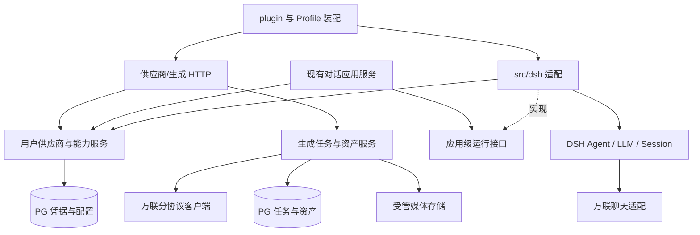

# 万联供应商完整接入 PRD

状态：用户已于 2026-11-10 采纳本期范围：沿原 W1/W2 核验动态目录、模型扩展及默认文本闭环；Claude/Messages 的进一步适配与真实验收作为后续条件项，不阻塞本期，现有实现、确定性回归及历史未验证事实保留。原 D1/D2 本地结果及限制已接受，见[对话成果入口](../conversation-service/complete/report.md)，本轮不重开或改写该接受。W1/W2 新候选仍分别验证和接受，旧改动、原件与草稿保留。必要隔离文本验证沿本人 Key 与既有授权；不提交推送发布、不迁移共享/生产库、不扩大 W3–W7 或非文本费用授权。返回[任务资料与成果](../index.md)。

## 1. 目标、范围与完成含义

目标是在当前 TypeScript Mio 服务中接入 OneLinkAI（万联，供应商类型 `onelink`）：用户保存自己的凭据后，能够按被授权的模型能力调用聊天、图片、视频、语音、音乐与素材库；请求、收费副作用、异步恢复及结果资产始终归属于该用户。DSH 继续提供 Agent 和 Session，Mio 承担供应商业务与对外服务，不维护第二套 Agent 循环。

“完整接入”包含供应商配置、模型目录及能力、协议适配、任务查询/取消、媒体输入输出、素材与音色归属、错误和用量，以及各能力真实联调。当前推进的本期是 W1 动态目录与 W2 模型扩展、默认文本闭环；本期接受不表示全部型号、Messages 后续项或整个万联 PRD 完成。旧界面、Python 类结构和历史兜底实现不作为必须复制的目标。

本计划覆盖 W1–W6 六个开发单元；按依赖逐项交付，不一次性建立全部执行记录。Agent 自主调用生成工具列为条件阶段 W7：它涉及新的权限和费用授权，不是仅接通供应商 HTTP 能力的前置，也不能在 W1–W6 中偷偷开放。正式前端、项目/剧本/分镜全业务、组织多租户、平台代付与充值计费、供应商市场、多地域部署及生产容量承诺不在本期。媒体能力先按用户归属成立，不要求先建设项目 CRUD。

初始实施与验收建议继续使用本地测试账号、合成或已获授权的素材、隔离存储；真实用户上线、保留/删除政策和容量另行决定。BYOK 不代表可以不经用户动作自动生成，也不代表供应商余额可由 Mio 准确推算。

## 2. 当前架构与需要改变的接缝

初次动态目录改造的历史基线为 Mio `681f7f05a1061ed1a8e5d55453cf49c8ca8261fb`、DSH `0.2.2-rc.1`，当时已有未提交 W1/W2 产物，HEAD 不代表当时完整候选。下表仅保留改造前接缝，不描述当前仍缺失这些实现。本轮沿已有动态目录与协议适配核验扩展，当前源码、验证和接受按原 W1/W2 记录核对。

| 对象         | 改造前事实                                                                                                                                              | 本方案如何承接                                                                                    |
| ------------ | ------------------------------------------------------------------------------------------------------------------------------------------------------- | ------------------------------------------------------------------------------------------------- |
| 认证         | 已有邮箱账号、持久登录及可信 `Authentication.identity`；接受范围见[认证成果](../ai-drama-foundation/complete/report.md)                                 | 复用身份解析；供应商、任务、素材等各自检查 owner，服务 token 不能代替用户                         |
| 对话服务     | [对话规范](../../conversations.md)与[HTTP契约](../../apis/conversations.md)已有本地候选；两协议代表有真实观察，接受仍待各任务核对                       | 复用owner、busy、去重、历史/SSE、取消/恢复，不重建API和消息库                                     |
| 模型选择     | [供应商服务](../../../src/providers/service.ts)和[目录](../../../src/providers/catalog.ts)仍用静态名单决定显式选择、默认与偏好；现有 modelRef 含分类    | 新版 W1/W2 改用当前凭据的动态目录准入及稳定身份，保留旧引用解析、一次绑定和去重顺序               |
| 目录与持久化 | [schema](../../../src/providers/schema.ts)目前仅 configs/preferences 两表，单个 discovery 保存最近一次观察；失败覆盖旧发现，缺同版本刷新乱序防护        | 分离最近成功快照与刷新尝试，新增 models/adaptations，完整响应原子发布；现有旧凭据写回防护继续保留 |
| DSH 模型入口 | [OneLink 适配](../../../src/dsh/onelink.ts)的 metadata/listModels/resolve/prepare 链仍依赖静态目录，公开 listModels 没有 owner 参数                     | 用户目录由 Mio 提供；请求作用域消费冻结事实，不能将各用户目录合并成全局可用名单                   |
| DSH 装配     | [Profile](../../../cordis.patch.yml)显式装载 Agent/Loop/Session/JSONL；当前无 provider 域保留显式 deepseek-official，启用后由 Mio 注册 OneLink 文本路由 | 保留最小 Profile、固定版本与公开 LLM 接口；BYOK 缺本人配置不回退，不加载默认 Web/SDK 大 Bundle    |
| 内容和元数据 | DSH 日志是对话正文权威，PG 保存归属/接收元数据；跨存储无原子提交                                                                                        | 路由身份进入 Mio 元数据；Key 不进 Session。生成任务/资产另有事实表，不双写对话正文                |
| 工具权限     | 根及 Agent 作用域均拒绝工具，[DSH 契约](../../integrations/dsh.md)要求拒绝不可被后注册 allow 覆盖                                                       | W1–W6 保持拒绝。W7 必须显式替换适用守卫策略并验证实际执行链                                       |
| 存储         | [PostgreSQL](../../integrations/postgres.md)已有按域持有池与显式迁移；[Redis](../../integrations/redis.md)目前只供认证限流                              | 新业务沿用资源责任，不借认证内部池；默认不新增 Redis 队列或缓存                                   |
| 媒体与任务   | 当前仓库没有可复用的生成任务、资产、上传和素材库业务                                                                                                    | W3/W4 随真实消费者建立必要能力，不把旧项目服务假设为已经存在                                      |

本 PRD 基于现有对话实现扩展供应商。W2 已采用本人 modelRef/默认及旧会话一次绑定，现行行为见[对话规范](../../conversations.md)和[HTTP](../../apis/conversations.md)。D1/D2 已接受，本轮在 W1/W2 候选核验受影响的内核、身份、持久化与对话回归，不重新安排 D1/D2 接受，也不将旧原件改绑到新候选。

本轮 W1/W2 已同步[供应商规范](../../providers.md)、[供应商 HTTP](../../apis/providers.md)、[万联集成](../../integrations/onelink.md)、[对话规范](../../conversations.md)、[对话 HTTP](../../apis/conversations.md)和[DSH 契约](../../integrations/dsh.md)：动态目录为成员权威，四表保存独立事实，fresh 准入冻结目录/适配版本；规范和实现进入同一候选重新验证，不继承旧静态名单证据。

## 3. 旧版能力基线与迁移覆盖

旧版调查来源是用户指定的 Mio v1.5 源码，历史核对日期为 2026-11-09；该检出没有可用 HEAD，不以目录名或代码注释中的历史实测声称线上可用。下表仅作能力迁移参考，公共构建、测试和部署不依赖本机相邻旧目录。需要保留的脱敏协议样例/旧快照应置于非生产迁移参考或测试资料，记录来源身份；`src/providers/legacy-snapshot.ts` 必须退出生产运行链路与构建覆盖，而不只是删除一个 import 后继续打包。

| 需求  | 能力与旧源码定位（相对旧仓库 `backend/app/`）                                                            | 协议与迁移要求                                                                                                                                        | 开发单元                   |
| ----- | -------------------------------------------------------------------------------------------------------- | ----------------------------------------------------------------------------------------------------------------------------------------------------- | -------------------------- |
| WL-01 | `routers/providers.py::oneclick_setup`、`services/user_api_key.py`、`models/provider.py`                 | 用户凭据、启停、连接测试、默认水印、模型默认项；加密保存和脱敏返回                                                                                    | W1                         |
| WL-02 | `services/onelink_presets.py`、`services/model_capabilities.py`、`services/model_capability_policy.py`   | 旧 ID/分类/参数与偏好仅供迁移核对；当前用户 Key 动态返回决定成员，协议/能力独立适配，不迁移静态白名单                                                 | W1，后续各能力补齐参数验收 |
| WL-03 | `services/llm.py`                                                                                        | 旧聊天使用 `/v1/chat/completions` 与 `/v1/messages`；新实现按可靠声明关联协议，不按 Claude/s-claude 等名称前缀推断                                    | W2                         |
| WL-04 | `services/image_gen.py`                                                                                  | GPT `/v1/images/generations` 与 multipart edits；Seedream `/volc/api/v3/images/generations`；Gemini generateContent/interactions；Kling/Vidu 提交查询 | W3                         |
| WL-05 | `services/video_gen/base.py`、`services/video_gen/seedance.py`                                           | Seedance/Vega 的 `/volc/api/v3/contents/generations/tasks`；文生、首尾帧、全能参考及音视频/水印参数按模型限制                                         | W4；认证素材联动在 W6      |
| WL-06 | `services/video_gen/kling.py`、`services/video_gen/vidu.py`                                              | Kling `/kling/v1/...`、Vidu `/vidu/ent/v2/...`；普通、主体参考、多镜头/多帧、数字人等按仍支持的操作映射                                               | W4                         |
| WL-07 | `services/video_gen/veo.py`、`services/video_gen/happyhorse.py`                                          | Veo predictLongRunning/operation/受保护下载；HappyHorse 提交/查询、生成与编辑                                                                         | W4                         |
| WL-08 | `services/tts.py`、`services/minimax_voice_runtime.py`                                                   | 万联 speech-* 使用 `/minimax/v1/t2a_v2`；异步长配音、文件上传/取回、音色查询、复刻与设计、分段情绪/字幕适用能力                                       | W5                         |
| WL-09 | `services/music_runtime.py`、`routers/music.py`                                                          | `/minimax/v1/music_generation`、lyrics_generation、music_cover_preprocess；音乐、歌词和翻唱                                                           | W5                         |
| WL-10 | `services/live_material_runtime.py`                                                                      | `/volc/openapi?Action=...`；真人认证、回调、素材组/素材增删改查、状态同步及 AIGC 素材验证                                                             | W6                         |
| WL-11 | `services/asset_task_handlers/creation_video.py`、`routers/creation.py::_run_creation_video_server_step` | 持久任务 ID、提交未知禁止自动重提、按原供应商查询、资产落库后再收口                                                                                   | W3–W6                      |
| WL-12 | `utils/onelink_base_url.py`、`services/onelink_error_mapper.py`、`services/http_client.py`               | 分协议地址、错误/请求 ID、脱敏、超时与并发；旧 TLS 补链、回退与重试逐项复核，不盲搬                                                                   | W1–W6                      |

旧预置表有 92 条：chat 55、image 11、video 22、voice 2、music 2。该数量仅是迁移参考，不再作为运行目录完整性、可选择或可调用的判据。当前用户 Key 的接口动态返回集合是成员唯一权威；`src/providers/catalog.ts` 不再构造静态模型白名单，不能将旧名单搬成 JSON、数据库 seed 或其他生产依赖继续限制新增模型。新增供应商模型无需修改生产模型名单或重新发版即可展示；复用已实现协议时，经可靠元数据或受控适配关联即可调用。

历史模型引用、用户偏好和旧能力差异逐项保留迁移处置；当前目录未包含的历史型号只标本账户当前不可用，不能凭缺项断言供应商永久下线，也不能用旧预设补成成员。W3–W6 原操作/协议族目标不因此删除；从实际目录选代表验证，目标无权限或无可用型号则对应项 pending 或按用户决定处理。发现、适配已实现、真实调用已验证分别记录，代表模型不证明所有别名和高级功能。音色和素材库操作仍单列，不受旧模型数限制。

## 4. DSH 与 Mio 的职责方案

| 能力                             | 复用对象                                          | Mio 增量及边界                                                                                      |
| -------------------------------- | ------------------------------------------------- | --------------------------------------------------------------------------------------------------- |
| Agent 执行、多轮上下文、消息结算 | DSH Agent/Loop/System Prompt                      | 只提供可信运行配置和业务工具入口；不复制 loop、inbox 或上下文管理                                   |
| Session 持久化/恢复/取消         | 当前 MioKernel + 官方 JSONL/Query/flush           | 保留现行对话回执与中断语义，处理路由绑定和用户归属，不把生成任务塞进 Session 作为唯一事实           |
| LLM 消息与流                     | `dsh-llm` 的 LlmAdapter、prepareCall、StreamChunk | 万联逻辑路由、模型能力、凭据绑定、协议差异和错误投影                                                |
| 通用聊天协议编码                 | 优先验证固定版 `dsh-llm-pi-ai` 的公开 PiAiAdapter | 能满足 BYOK 和万联 wire 行为就复用；不足时仅实现有证据的专用协议适配，仍接同一 LLM seam             |
| 账号与 API 身份                  | 当前认证及 HTTP 响应原语                          | provider/task/asset/voice/material 的 owner 条件和操作授权；不复用 DSH 本机设置页作为 SaaS 账号配置 |
| 供应商配置和目录                 | 既有 W1 加密存取、owner 与偏好服务                | Mio 改造动态目录、独立适配和用户偏好；保留凭据版本及隔离，不修改进程环境变量切换用户                |
| 图片/视频/音频协议               | 旧源码只作协议依据                                | Mio 分能力客户端，输入准备、提交/查询/取消与结果解析；不强行通过 chat completion 表达生成           |
| 异步任务、资产与费用状态         | PostgreSQL 驱动/资源约束                          | Mio 保存请求身份、外部任务、下载和资产状态，管理恢复；DSH Session 不是通用任务队列                  |
| 工具声明、执行与日志             | 条件阶段复用 DSH Tools/Native Executor            | Mio 定义业务授权、额度/参数、资源归属和任务幂等；工具只转调已验收服务                               |

候选依赖方向如下；目录名是实施落点建议，随实际消费者落地，不预建空框架。

建议落点：`src/providers/` 保存凭据/目录/运行解析，`src/integrations/onelink/` 保存网关协议客户端，`src/generations/` 保存任务应用服务，`src/media/` 保存资产与受管存储，`src/dsh/` 保存 DSH 桥接。普通业务只依赖不含 DSH 类型的接口，不能从 `src/conversations/` 直接导入框架。新 PG 所有者、模块导入、类型与构建覆盖随首个消费者修改护栏；不扩大成全部 src 可任意导入。

### 4.1 聊天适配选择与用户隔离

内部可用 `onelink-openai`、`onelink-anthropic` 两个协议路由表达同一个逻辑供应商，模型 ID 原样保留，不能根据展示名删去 s-、线路后缀或强制大小写归一。当前 DeepSeek 官方适配不能代表万联中转的 DeepSeek/其他模型。

固定版本源码确认 PiAiAdapter 可公开导出，支持自定义 OpenAI/Anthropic 路由；但 `resolveApiKey(provider, profile)` 不接收 Mio 用户身份，单个全局 profile 加 apiKeyEnv 并不能完成本需求。W2 先验证公开构造/配置入口、必要 peer 依赖和无环境凭据回退，再选择最小实现：由 Mio 在已授权运行中绑定不可变供应商/凭据快照，通过作用域适配或受控包装委托通用编码。只读模型元数据准备不得解密任意用户凭据。

一次新模型请求须在准入时冻结用户、conversationId、内部 dshSessionId、requestId、providerConfigId、稳定模型身份与原始 modelId、credentialVersion、catalogVersion、适配声明版本和 operation/profile；只有服务端 owner 查询产生该绑定。凭据密文只在受控边界解密为该请求内存快照，不写入回执或 Session。若通过 sessionId 查询绑定，缺失/过期/不匹配就拒绝。并发调用不能改共享实例的当前 Key、profile、headers 或 process.env；辅助调用没有可信绑定也拒绝。metadata、resolve、prepare 和 dispatch 必须消费同一次绑定，刷新不改变在途模型或版本。

DSH 的全局 `listModels(provider)` 没有 owner 参数，不承担用户目录发现与授权，不能返回各用户目录的并集、首个用户或上次请求的名单。用户模型列表由 Mio 认证入口返回；无可信用户/请求作用域的 DSH 模型入口不得解密凭据或授予调用资格，必要时返回空列表或明确不可解析。新版 W2 须在固定公开接口内落实请求作用域元数据路径，清除 `src/dsh/onelink.ts` 的 metadata/listModels/resolveModel/prepareCall 及其间接静态依赖，不改上游、不复制 Pi 编码或 Agent/Session/持久化。

旧 Claude 适配会过滤 tool 角色、丢弃 thinking/tool_use，只适合其原文本出口，不能原样迁移成 Agent 适配。新适配在 DSH 内部保留受支持的文本、工具调用/结果、usage、结束原因及必要 replay 信息，正确传递 AbortSignal，并按公开接口加入 attributionHeaders；公开历史和 SSE 仍按当前白名单隐藏推理与内部工具数据。工具协议测试使用隔离无副作用夹具，生产守卫继续拒绝。还须核验旧万联 Bearer 鉴权与通用 Anthropic 请求头的差异，不能从接口路径相同推导兼容。模型上下文/输出上限、结构化输出与推理选项采用核实后的能力值，不能直接采用未知模型的 SDK 大容量默认值；不支持的请求在出站前明确拒绝。

### 4.2 用户配置、模型选择和凭据生命周期

用户自行配置 Key；每用户一个逻辑 onelink 配置，不存在平台或其他用户 Key 兜底。网关固定 `https://api.onelinkai.cloud`，用户不能提交任意 URL、认证头或代理。凭据继续使用部署显式注入的独立主密钥及 AES-256-GCM，AAD 绑定 owner/配置/凭据版本/主密钥 ID；保护与恢复沿[现行规范](../../providers.md)。本次调整目录持久化与资格，不引入管理员角色、供应商市场或通用规则平台。

#### 4.2.1 目录事实、适配声明与用户偏好

- **目录事实**：仅当前配置、当前 Key 的完整成功响应建立成员。原始模型 ID 保留大小写、标点及线路后缀；稳定模型身份由配置与精确原始 ID 确定，不包含分类、协议或适配状态。分类后补、适配变化及同 ID 再次发现均更新同一实体。缺元数据使用 null/unknown，未知分类不默认为 chat。
- **适配声明**：官方[模型列表文档](https://docs.onelinkai.cloud/8882392m0)没有承诺 `/v1/models` 逐模型完整协议/能力；[文本协议文档](https://docs.onelinkai.cloud/8882612m0)列出的协议也不是每个模型都支持这些协议的保证。只有足够可靠、可追溯的结构化元数据才自动关联已有 operation/profile；名称前缀、展示名和自由描述不足以判定协议，未知模型不能统一兜底 OpenAI。上下文、价格、工具、媒体及参数能力未知就保留未知，不能用 SDK 默认值或旧快照补造。
- **受控维护**：元数据不足的模型仍立即在用户目录展示为待适配。部署侧的受控配置导入/更新入口只可定位本配置中已发现的模型，为其选择服务端已实现的 operation/profile，并保存声明来源、来源版本和独立适配版本；不得创造成员、上传执行代码、配置任意网关或把人工声明写成已验证。人工补充的协议/能力信息明确标为人工声明及依据，可信程度和未验证项如实展示；无支持依据时不宣称能力。普通用户只管理启停/默认偏好。配置格式和路径在 W1 C0 定稿，沿已有部署职责，不新建通用后台。
- **资格与验证**：目录成员、协议实现状态、适配声明及真实验证状态分别返回。当前成员、同凭据有效快照、配置/用途启用及已实现适配共同决定新请求资格；真实验证只由对应实际观察登记，不能由配置开关伪造。适配已实现且未实测的项可以在授权下调用以取得观察，但不得展示为“已验证”。默认项按业务用途约束，未知分类不产生 chat 默认，测试默认不替用户设默认。

#### 模型增长时的扩展方式

后续显式回扫成功后，新模型立即进入当前用户目录；发现、已实现适配、真实验证分别记录。扫描不自动生成或设置默认，也不按名称猜协议。

| 变化                       | 最小扩展与验证                                                                                                                                  |
| -------------------------- | ----------------------------------------------------------------------------------------------------------------------------------------------- |
| 新 ID 完全兼容已有 profile | 通过可靠结构化元数据或有依据的受控声明关联已有 operation/profile，复用调用链；无需新增生产型号名单或重新发布，核对精确出站 ID、协议及请求版本。 |
| 同协议的参数或返回语义不同 | 依据文档或实际失败样本，在适配层补最小差异和能力校验，复用身份、会话、流、取消及持久化；不以任意参数透传宣称兼容。                              |
| 新协议或操作               | 增加有实际消费者的实现，同步类型/声明准入、必要存储约束、固定目标/传输政策及新旧路径回归；未知 profile 明确拒绝，不能进入 OpenAI 默认分支。     |

当前只保留两种已实现文本 profile，集中维护路由、公开 codec、端点和已核实兼容项；不预建每型号一个类、通用 DSL、代码上传或后台试调平台。稳定身份不包含 profile，扩展不重建业务会话或消息库。使用启动后回扫新增多个未知 ID（含大小写差异、后缀及误导性名称），经声明进入正式用户 API/DSH 链的测试证明已有协议复用；未适配项可见且无出站。新协议仍需代码与回归，配置不能创造未实现能力。

#### 4.2.2 持久化字段与约束

沿用所属业务的 PG 池与显式迁移，保留并调整 configs/preferences，新增 models/adaptations。下列是本期迁移必须表达的字段和约束，SQL 类型/可逆命名由 W1 C0 结合现有 schema 定稿；不能只建四个空概念，也不新增跨库外键。

| 表                               | 必需字段与约束                                                                                                                                                                                                                                                                                                                                                                                                                                                                                                                                                                                                                 |
| -------------------------------- | ------------------------------------------------------------------------------------------------------------------------------------------------------------------------------------------------------------------------------------------------------------------------------------------------------------------------------------------------------------------------------------------------------------------------------------------------------------------------------------------------------------------------------------------------------------------------------------------------------------------------------ |
| `mio_provider_configs`           | 保留 `id/owner/enabled/revision`、水印、加密格式/密文及 `credential_version/master_key_id`；owner 的 onelink 配置唯一。分别保存 `catalog_version/catalog_credential_version/catalog_succeeded_at`（尚无任何成功时均为空；成功空目录也有版本/时间）、递增 `latest_refresh_seq`、`last_attempt_seq/last_attempt_credential_version/last_attempt_started_at/last_attempt_finished_at/last_attempt_status/last_attempt_error_code`，以及当前凭据 `credential_auth_state`（unchecked/valid/rejected）。轮换后旧成功版本可保留为历史，但与当前凭据不匹配即无当前快照；错误仅脱敏码，失败不覆盖成功快照；版本和序号为受约束的递增值。 |
| `mio_provider_models`            | `model_key` 为稳定主键；`provider_config_id/raw_model_id` 精确、区分大小写唯一，外键指向本配置。保存受限且脱敏的 `supplier_metadata`、可空分类及元数据来源、`credential_version/catalog_version`、`first_seen_at/last_seen_at`、`membership_state`（current/removed/historical）。仅历史引用且从未有效发现的行没有发现时间/快照版本；不能伪填。当前成员必须属于本配置当前凭据及成功快照，移除或轮换保留实体；同 ID 再出现复用 model_key。                                                                                                                                                                                      |
| `mio_provider_model_adaptations` | `provider_config_id/model_key/operation` 唯一，复合归属外键不能关联其他配置；只能为有有效发现来源的条目建立适配，写入时核对当前成员。保存受服务端注册表约束的 `profile`、`declaration_version/source/source_version`、可空且有来源的能力声明、`verification_status/verified_at/evidence_ref` 及受验凭据/目录/适配版本。更新声明使相关验证待重新核对；历史记录/引用保留，配置导入不能设置 verified。实现状态由实际服务端代码能力决定。                                                                                                                                                                                          |
| `mio_provider_model_preferences` | 以 `provider_config_id/model_key/usage` 唯一保存 `enabled/is_default/updated_at`；usage 是服务定义的业务用途，不是分类或协议，也不改变模型身份。每配置/usage 至多一个默认，用部分唯一索引保证；设置默认在同一事务核对成员、适配用途和启用状态。未知分类保持可空且不自动生成 chat 用途偏好。移除/轮换/停用时保留偏好行及原默认目标，返回默认失效原因，不自动另选模型；有效性按当前资格判断。                                                                                                                                                                                                                                    |

配置、模型、适配和偏好查询始终带可信 owner/config 条件；复合外键及唯一约束支撑跨用户隔离。当前目录/适配/偏好与凭据在同一一致读取中冻结，不能分别读出不同时点的资格再拼装。对话 PG 可与供应商 PG 分离，按现有跨存储回执规则持久脱敏版本绑定，不承诺跨库原子提交。

#### 4.2.3 显式刷新、失效和请求冻结

刷新由用户显式动作触发，复用/调整当前目录测试入口，不在保存、读取、启动或每次调用时自动访问供应商。开始时持久分配本配置递增刷新序号并绑定 credentialVersion；完整校验响应结构、精确 ID、数量/体积、元数据及完整性后，在一个事务中发布新的成功快照、成员增删状态与相关默认有效性。不得先写半份列表或把格式错误当成功空目录。重复精确 ID 的冲突元数据不能任意择一冒充完整成功。

| 结果/变化                          | 目录与新请求行为                                                                                                                                                                               |
| ---------------------------------- | ---------------------------------------------------------------------------------------------------------------------------------------------------------------------------------------------- |
| 当前凭据从未成功                   | 无当前可用快照；新模型选择/调用拒绝，展示尚未取得目录。历史行不补成当前成员。                                                                                                                  |
| 成功空目录                         | 记录成功时间与新目录版本、当前成员数 0，旧成员移除、默认失效；不能等同网络失败或回退旧目录。                                                                                                   |
| 超时、限流、上游临时失败或非法响应 | 只更新最近尝试/脱敏错误；保留同凭据版本的最近成功快照，明确成功时间、stale 和失败原因，允许其中仍启用且已适配项继续使用。没有同版本成功快照则仍无资格。                                        |
| 当前凭据认证失败                   | 保留历史成功事实供查看，但标记凭据 rejected 并阻止新调用；后续刷新开始或临时失败不清除该阻断，须同版本显式刷新成功或换 Key 后重新成功建立资格。                                                |
| Key 轮换                           | 原位替换密文、递增凭据版本；旧目录只供历史查看，立即失去新选择/调用资格。启停、模型实体、偏好/默认目标及旧回执保留，新版本须重新成功发现；不把旧快照标成新凭据的 stale 可用目录。              |
| 并发刷新                           | 提交时同时核对配置、凭据版本和最新发起序号，只有仍为最新尝试的结果可写；较早发起的晚到响应不能覆盖新成功或新错误，旧凭据的任何响应不得写回新版本。被取代的结果如实返回已失效，不伪称发布成功。 |
| 成功目录移除模型                   | 禁止新选择、新默认和新调用，默认明确失效且不自动替换；保留稳定实体、历史引用、偏好和回执。再次出现使用同一身份，并按当前适配/凭据重新核对资格。                                                |

provider 域启用后，新会话的显式 modelRef/业务默认、偏好修改、旧无绑定会话的一次绑定及已有会话的每次 fresh 输入均检查上述资格；已绑定会话不随默认或目录变化换模型。成员移除/凭据无效时，新输入拒绝且不产生新的收费接收，原历史和回执仍可读。原 requestId 先做 owner/内容去重，同输入返回已有回执，不先做当前目录/默认/解密校验，也不因版本变化重发；异输入保持冲突。

准入时冻结的模型/凭据/目录/适配版本贯穿该轮，刷新、移除、轮换和偏好变化不改在途模型或重新选模。重启恢复已持久版本事实与 unknown/终态，不从旧静态目录或历史绑定恢复新请求资格，也不恢复收费执行。无 provider 域的显式 legacy 路径保持现行边界；BYOK 缺配置/资格不回退 legacy 或其他 Key。W3–W6 出现外部任务/资源后再确定历史密文有界保留与查询政策，本期不新增历史 Key 平台。

#### 4.2.4 迁移与错误契约

迁移按显式命令、备份与结构检查实施，本轮只在隔离测试库验证，不执行共享或生产业务库迁移。先识别旧 discovery 的凭据版本、成功状态及完整来源，只承接仍有效的动态成功发现；失败的空 ids、无法证明完整性的旧观察或不同凭据版本都不能生成成功快照。已有用户偏好、会话 modelRef 和回执引用可生成 historical 行以保留身份，但不能 seed 旧 92 条为可用目录。无有效发现时从当前凭据“从未成功”开始，等待显式刷新。

旧 `onelink:<category>:<rawId>` modelRef 保留兼容解析：分类仅供解析旧格式，原始 ID 按旧格式边界无损取得并结合所属配置映射到稳定 model_key；不按新分类重造实体、不改写原回执/日志、不改变既有请求摘要。确实无法解析的历史值保留原文及不可用原因，不能猜成另一个模型。缺于当前目录的历史引用标不可用；分类后补及迁移重跑必须保持同一身份与偏好。

W1 C0 固定目录刷新/用户模型列表/偏好/受控适配维护的响应和错误分类，W2 C0 将同一分类接入默认/显式选择、旧绑定和 fresh 输入；缺配置、未发现、模型已移除、待适配、用途不支持、默认失效、凭据认证失败/不可解密、刷新被取代及临时失败必须可区分。字段明确返回目录版本/成功时间、最近尝试、stale、成员/适配/验证/用户偏好状态，精确 HTTP code 在实施时同步对应 API 正文，不透传上游正文/Key。相应失败不能创建模型调用或伪成功回执。

迁移验证计划覆盖空库、旧成功/空成功/失败/轮换数据、仅历史引用、重复迁移、分类后补、约束冲突与事务中断；故障后保持可诊断旧数据或完整新结构，不留下半迁移可运行状态。重启验证成员/默认失效、同版本 stale、认证阻断和旧回执均持久，旧程序/不兼容结构不得静默退回静态名单。恢复按备份和实际版本执行，不承诺自动降级。确定性验证使用隔离 PG、虚构模型和协议替身；真实目录与调用另行显式验证。

既有 W2 公开 PiAiAdapter/createProvider、可信 turn 绑定、Bearer、无环境兜底/重定向/自动重试、公开投影和 unknown 回执保护继续复用。未知供应商 context/价格等对外保持未知；SDK 内部哨兵或 Mio 输出政策不包装成供应商能力。

### 4.3 任务、资源和费用副作用

供应商的提交、查询、下载、取消各自有独立结果。生成任务建议保存 owner、requestId、规范化输入摘要、模型/能力/配置版本、上游任务 ID/协议查询信息和状态；同 owner/requestId 同输入返回原任务，异输入冲突。数据库唯一约束与事务控制本地重复，不能宣称外部 exactly once。

建议区分：accepted、submitting、submitted、processing、materializing、completed、failed、unknown，以及 cancelRequested/cancellationOutcome。HTTP 接收、上游生成完成、媒体已持久与本地任务完成分别可观察。同步图片/配音也进入本地任务：收到产物但落库失败时只重试下载/落库，不能重新生成。一个任务多输出时保留逐项成功/失败与资产引用，不用一个 completed 隐藏缺图。

第一次有异步消费者时建立最小持久调度：PG 保存下一次查询时间、次数与执行所有者；一次执行只做一个有界 submit/poll/落库步骤。建议初期单服务实例按独占业务资源启动，不能把现有对话 advisory lock 当生成的跨进程 fencing。分布式 worker/Redis 队列需要实际容量证据后另定。

提交前持久记录意图；POST 可能已到达上游但没拿到 ID，进入 unknown，停止自动重提。已知 ID 在检查取消/执行租约之前尽力持久保存；恢复时只按原供应商查该任务。供应商若支持幂等键或按外部 ID 查询，经验证后才用来缩小 unknown，不凭本地 requestId 推导上游幂等。没有可查询身份的未知请求由用户核对，不能换 ID 自动重跑。

安全的查询/下载可在明确总期限和次数内重试；生成 POST、流中断重发、创建素材/复刻音色等不能套同一重试。保持当前 Profile 不自动装载全局 llm-retry；若采用 SDK 自带重试，必须核对并限制，避免和 Mio 重试叠乘。429、余额不足、线路未绑定、参数不支持、内容拒绝、断连/超时分别分类，保留脱敏上游 request ID 与原始事实，不把不确定结果改写成“未扣费”。

取消回执表示请求被记录，另查供应商是否确认停止；旧版只有 Seedance 有上游删除分支，其他协议须逐项确认。断开 SSE 不取消任务；登录失效拒绝新操作，已受理动作按选定授权快照结算，凭据撤销另按 O2。费用状态保留 usage/供应商已报告费用/unknown，缺价格或退款依据就不估成实际金额。测试预算须有用户授权，运行时总预算与对话 token 上限不是一回事。

### 4.4 媒体、音色和素材库

先建立 owner 所属的受管 Asset ID，调用方提交资产引用；服务端检查类型、大小、格式、归属，再按协议转换为 Base64、multipart、受限公开 URL 或万联 `asset://`。外部拉取需限制协议、地址/重定向目标、字节和时间；供应商鉴权头只能发往核准上游，不能跟随重定向泄露到任意结果地址。

存储后端与保留条件在 O4 选择。首期候选为受管本地持久目录加鉴权下载；需要上游访问的输入通过短期受限 URL 或已选对象存储提供，不能把 localhost、临时 blob URL 或依赖本机隧道的地址当生产契约。Base64/临时上游 URL 归一并持久后才登记稳定资产。下载成功但元数据提交失败须保留可对账身份；通过同 task/output 唯一性避免重复 Asset，并有界清理孤儿临时文件。FFmpeg 仅在分段音频合成、字幕或必要媒体检查的真实消费者出现时接入，明确超时、关闭与制品环境。

音色、上游文件、素材组与素材均保存本地 owner、providerConfigId 和上游 ID。同用户不同万联凭据版本的资源不能默认互通；万联账号身份无法核实时，换 Key 不自动把旧音色/素材重新认领。真人认证回调必须绑定单次会话、到期时间和防重放验证；返回路径受限，不能仅凭客户端宣称认证完成。收到回调后向上游核对，再允许 Active 素材参与生成。素材库线路未绑定必须返回可操作的脱敏错误，不把 `/models` 成功当作该能力可用。

完整素材库覆盖组/素材创建、查询同步、更新删除、真人认证及 AIGC 素材验证。删除本地资产、删除上游素材和撤销认证是不同副作用，须分别表达，已有任务引用不得悬空。旧版按项目建 AIGC 组的便利流程本期先用 owner 所属素材组承接；未来项目模块只提供业务关联，不重复实现供应商客户端。

## 5. 候选服务面与规范落点

下表描述服务职责和权限：W1/W2 已实现入口以现行[供应商 HTTP](../../apis/providers.md)和[对话 HTTP](../../apis/conversations.md)正文为准，其余未实现部分仍为候选，不表示已开放。可逆命名细节由实施者集中定稿，新增权限、数据保留或收费动作需在相应 C0 收口；现有文本授权沿 O1，不重复要求。

| 服务面           | 候选操作                                                         | 身份、返回与副作用                                                                                      |
| ---------------- | ---------------------------------------------------------------- | ------------------------------------------------------------------------------------------------------- |
| 用户万联配置     | 查询/保存/轮换/启停；显式连接测试；删除留后续引用政策            | 当前登录用户；只返回 masked/hasKey/版本/测试状态；提交 Key 仅此入口接收，测试只列模型，不隐式做收费生成 |
| 模型目录与默认项 | 展示当前动态成员及待适配项，历史不可用项分明；按业务用途设置默认 | 全部当前成员立即展示，不以适配或启停过滤成隐藏名单；调用资格单独返回，默认必须符合用途，失效不自动替换  |
| 受控适配维护     | 为已发现成员关联服务端已实现的 operation/profile，记录来源/版本  | 沿部署职责实施，不向普通用户开放协议/网关写入；配置不能创造成员、执行代码或真实验证事实                 |
| 对话             | 复用现有 conversations；创建时 modelRef/默认项                   | 不传原始 Key、URL、DSH ID；保留原请求回执和历史权限，W2 更新确有变化的字段与错误                        |
| 生成任务         | 提交图片/视频/语音/音乐任务、查询列表/单项、请求取消             | owner 校验和 requestId；返回 Mio taskId/阶段/资产/脱敏错误；上游任务 ID 作为内部查询依据                |
| 媒体资产         | 上传、查询、鉴权下载、按保留政策删除                             | owner 检查、类型/容量限制；删除不能暗中取消付费上游任务                                                 |
| 音色与素材库     | 音色查询/复刻/设计，认证会话和素材组/素材管理                    | 上游 ID 绑定用户供应商；创建/删除有副作用，回调不是公开配置写入口                                       |

供应商与任务 HTTP 应沿现有精确 Origin、用户 Cookie、输入白名单、有界正文和脱敏响应方式实现，数值上限根据本域输入确定，不直接复制对话 16 KiB 到媒体上传。新增规范随首个实现切片进入 `docs/integrations/`、`docs/apis/` 及相应业务规范并接回权威导航；本轮不预建空规范页。跨供应商通用抽象只有第二个真实消费者或明确公共契约需要时再引入。

## 6. 待决项、建议与最小解决动作

用户已采纳第 4.2 节动态目录、适配、持久化及失效方案；这些不再作为待确认产品选择。当前授权续接原 W1/W2 实施，沿用 BYOK、本人测试 Key、文本调用无总上限及精确测试 ID `deepseek-v4.1-flash`。多模态选型仍由实施 Agent 按阶段进行，非文本费用另核对。C0 只收口方案落到现有代码/契约的必要细节；实现后的行为与真实账户可用性属于 C1，不预填成功。

| 项                          | 建议与待决定内容                                                                                     | 最小解决动作及影响                                                                                                  |
| --------------------------- | ---------------------------------------------------------------------------------------------------- | ------------------------------------------------------------------------------------------------------------------- |
| O1 开发与真实调用授权       | 当前用户已授权原 W1/W2 实施与必要隔离文本验证，沿用本人测试 Key 和文本调用无总上限授权               | 文本验证从测试账户当前目录精确匹配 deepseek-v4.1-flash，缺失不自动替换；不提交发布，非文本费用另核对                |
| O2 Key 与在途任务           | W1 工程采用当前密文+递增版本及独立部署主密钥；W2 在途 HTTP 用内存快照，无历史密文平台                | W1 主密钥恢复见规范；W3–W6 有外部引用时再确认有界保留、删除/撤销、unknown 与主密钥迁移                              |
| O3 目录、模型选择与适配维护 | 已采纳当前 Key 动态集合唯一权威、稳定身份、四表、受控适配与用途默认，详见第 4.2 节；不新增管理员角色 | W1 C0 定稿 schema/刷新/错误与受控导入格式；W2 C0 覆盖全部服务和 DSH 静态消费者及旧绑定兼容，随后实施取证            |
| O4 存储与运行规模           | 建议先本地单实例与隔离持久存储；上游可取的输入单独解决，结果不保留为临时 URL                         | W3 前确认后端、容量/文件上限、保留删除和可达方式；W4 确认轮询预算、并发、停机恢复。对象存储或多实例另有明确资源授权 |
| O5 模型/操作覆盖与上游变化  | 动态成员与历史引用分开，旧 92 条仅作迁移参考，按实际协议/参数差异扩展                                | W1/W2 本期核验新 ID、已有 profile 复用及 DeepSeek 闭环；Messages 后续启动，W3–W6 各自选代表，不用历史探针绕过资格   |
| O6 私有素材与外部资源       | 真人认证、声音复刻、素材创建/删除的授权、回调部署和资源保留须明确                                    | W5/W6 使用合成或已获授权素材；确认外部资源管理与回调验证契约。缺公网回调只阻塞其真实流程，不阻塞协议替身验证        |
| O7 Agent 生成工具           | 候选先允许用户显式发起已知业务动作；自动生成需次数/成本限制、参数约束、取消与再次执行语义            | W7 触发时明确允许工具清单、用户意图授权和审阅边界；未确认继续全拒绝，不用工具调用夹具通过替代生产授权               |

## 7. 分阶段开发计划与验收

各 W 单元沿[统一 C0/C1 生命周期](../../coordination.md#当前任务的生命周期)推进；新版 W1/W2 继续原执行记录及成果键，不新建重复任务，先审阅新要求与当前代码/规范差距，更新相关 C0 判断再实施。旧证据及草稿保留，按新要求与候选重新核对，不自动继承通过或改成 complete。文档维护的 C1 不等于开发就绪或功能已接受；W3–W7 不因本次规划而启动，也不预建记录。

能力依赖：W1 → W2；W1 → W3 → W4；W1+W3 → W5；W1+W3 → W6，W6 的认证素材生成联动消费 W4。本轮沿原 W1 → W2 核验动态目录、模型扩展及默认文本闭环。D1/D2 已接受，只做受影响回归；媒体阶段与 W7 未启动，不预建后续记录。

W1/W2 分别核验和接受。Messages 的具体完善与真实验收为后续条件项，不是本期 W2 的退出前置；已有两协议确定性测试继续保留。默认文本通过还须配合扩展、隔离、恢复、完整检查与审阅，才能准备本期结果。已接受 D1/D2 的关系见[原对话 PRD](../conversation-service/prd.md#对话交付衔接)。

### W1：用户万联配置与模型能力目录

- **结果/范围**：保留用户 Key 的加密/轮换/启停，交付当前凭据动态目录、独立适配关联和用途偏好；新 ID 无代码改动即展示，元数据不足仍可见待适配。建立 WL-01/02/12 新契约。非目标为生成业务、后台探测、通用规则平台及正式 UI。
- **C0 决定/依赖/缺口**：按第 4.2 节收口目录唯一权威、稳定身份、四表字段/约束、完整同步/失效、受控适配维护入口、迁移和错误契约；核对当前认证/PG、旧发现与历史引用格式。已采纳产品边界无需重复确认，命名/SQL/导入格式等实现细节定稿；W2 的新准入和 DSH 接缝同步列入依赖，不能只改目录展示。
- **C1 顺序**：先迁移 schema、兼容旧引用并将旧快照移为非生产迁移参考，移除供应商域静态名单；再实现版本化原子刷新、成功/尝试分离和乱序/轮换防护；接动态目录展示、可靠元数据自动关联、受控适配导入与用户启停/用途默认；向 W2 提供同一读取的模型/凭据/目录/适配快照。可消费候选就绪即可接 W2 完成 DSH 消费者改造，再联合核验生产运行及构建不依赖旧名单，不以 W1 complete 阻塞 W2。同步供应商、HTTP、万联及 PG 消费者规范，验证迁移/重启/失败和双用户；启动不自动迁移、探测或生成。
- **验收/接受**：A1/A2/A7 及下文“动态目录改造必验项”的 W1 覆盖全部核验；保留加密篡改、主密钥缺失/错误、masked 值、并发保存/轮换与解密恢复判据。新 ID 展示、配置不生成成员、空成功/临时失败/认证失败/乱序/移除和旧引用迁移必须有证据；旧 92 条数量不作为运行目录判据。相关隔离 PG、正式 Profile 与完整检查通过，真实目录单独显式验证；缺真实项保持 pending，不沿用旧草稿直接接受。

### W2：用户绑定的万联聊天接入 DSH

- **结果/范围**：本期交付动态目录后的模型扩展、用户凭据绑定及默认文本真实闭环，涵盖多轮、流、历史、取消与恢复。保留已实现 OpenAI/Anthropic 适配、内部消息语义及确定性回归；Claude/Messages 的进一步完善与真实验收后移。非目标为全型号实测、生产工具、任意网关、对话中换型及第二套 Agent。
- **C0 决定/依赖/缺口**：本期/后续边界已由用户确认；消费原 W1 的当前目录/适配/身份契约和已接受 D1/D2 实现。核对新 ID 在选择、metadata、prepare、dispatch 中精确传递及未知 profile 拒绝，不增加新协议或未知参数开关。改变公共输入、权限、持久化或副作用的未知只阻塞相应实施，Messages 代表缺口不阻塞本期。
- **C1 顺序**：沿现有动态资格与请求快照核对显式/默认选择、稳定旧引用及受控适配；补齐有依据的协议选择/声明校验缺口，验证新增 ID 经已有两协议到达正式用户 API/DSH 出站。保留去重优先、版本冻结、原生恢复及旧协议测试；同步规范，再以当前目录精确 `deepseek-v4.1-flash` 核验真实闭环，执行原对话回归、打包和完整检查，不重开 D1/D2。
- **验收/接受**：A3/A4/A5 及动态目录必验项的本期覆盖通过；交错用户、同 ID 不同配置、辅助调用、轮换/禁用/移除、默认失效和已有会话新输入不串用或回退。一次回扫的多个源码外新 ID 经声明和已有 profile 进入正式对话链，精确出站 ID/协议及持久绑定版本一致；未适配、未实现 profile 无出站。保留两协议工具/replay、过滤、流/取消的确定性回归。本期唯一必需真实文本代表为当前目录精确 DeepSeek，至少两轮、HTTP 流/终态、历史、取消与重启无重放，记录 request ID/usage/finish 和未知项。完整检查、质量/规范及独立审阅齐备后 prepare，真实接受后 complete；Messages 后续未验不阻塞，也不记为通过。

#### 对话验收衔接

本期默认文本闭环要求当前凭据动态目录精确存在 `deepseek-v4.1-flash`，关联已实现适配并通过用户准入；经正式 Mio Profile 的登录用户 API 完成至少两轮上下文、真实流/终态、历史和进行中取消，模型/凭据/目录/适配版本及结算可核对，重启不重放。缺该 ID 不静默替换，不设为全部用户默认。目录连通或直接 SDK 成功不能代替本闭环；D1/D2 已接受结果保留。

Claude/Messages 后续项在后续回扫取得当前目录内、具有可靠协议依据的代表，并明确启动该能力完善/验证时推进；单纯发现新 ID 不自动发起收费验证。届时经已有或补齐的适配完成至少两轮、真实流/终态、取消、历史/恢复和结算观察，核对受影响回归并独立接受。无代表或失败时后续项继续 pending，不影响本期结果。既有 `claude-sonnet-4.5-20250929` 的 `catalogDiscovered=false` 原件仅作历史协议观察；旧 pending/失败保留，不改为 pass 或以改期冒充完成。

| 时点              | 本阶段的衔接动作                                                     | 退出条件与去向                                            |
| ----------------- | -------------------------------------------------------------------- | --------------------------------------------------------- |
| W1/W2 开发期间    | 复用已接受 D1/D2 内核和用户入口，核验动态目录、适配与默认文本        | 保留受影响回归及旧接受，Messages 后续项不阻塞本期         |
| W2 改变对话路由时 | 在适配层收口协议选择与实际参数差异，同步规范并验证身份/版本/生命周期 | 新候选与观察在原 W1/W2 核对，不改写旧接受                 |
| 默认文本闭环后    | 汇总本期扩展、DeepSeek 真实闭环及对话回归，完成检查与审阅            | 原 W1/W2 分别 prepare/接受/complete，不重做 D1/D2 交付    |
| Messages 后续项   | 明确启动且取得当前目录内可靠代表后，补适配与真实验证                 | 后续结果独立核对，不阻塞本期 W2，历史目录外观察不授予资格 |

D1/D2 原判据与已接受事实保留；W1/W2 在新候选验证受影响关系，不改标签迁移旧日志。本期必需项失败或缺证仍需修复/补证，Messages 后续缺口单列。媒体、工具和生产部署分别判断，不由本期文本结果推导完成。

### W3：图片生成、编辑与受管资产

- **结果/范围**：覆盖 WL-04 的 GPT、Seedream、Gemini、Kling/Vidu 图片协议及当前目录支持的生成/参考图/编辑/扩图等操作，产物可通过稳定 Asset ID 查询下载。建立实际所需上传、异步图片短查询和结果持久化。非目标为画布编辑器、项目/分镜和视频工作流。
- **C0 决定/依赖/缺口**：实施授权、W1；O4 的存储、容量、保留/删除和上游输入可达方式；O5 确认目标操作。公网地址/对象存储未定时可做隔离协议验证，不能宣称真实参考图流程完成。
- **C1 顺序**：先 owner 资产/上传下载与迁移；再建立任务身份/提交状态和逐输出结果；实现参考图/mask 准备及各协议参数/响应；异步图片复用本域短步骤调度；最后覆盖媒体落库、部分成功与下载重试。必要图像/存储契约随实现进入候选，不先建无人消费的通用队列。
- **验收/接受**：A1/A6/A7：每协议至少一个受支持生成场景，生成/编辑/多图/异步等不同分支分别真实验证；无参考图与带参考图请求不同、格式数量尺寸与水印按目录执行。跨用户引用、不可达/超限/伪类型/恶意重定向被拒；URL 与 Base64 结果重启后可下载。模拟“生成成功→下载或提交失败”确认不再次生成，同输出不重复建 Asset，多图部分失败可见。目标模型/操作清单残留未验项不能算完整图片接受。

### W4：异步视频与恢复

- **结果/范围**：接通 Seedance/Vega、Kling、Vidu、Veo、HappyHorse 的目标视频操作，实现提交、单次查询、取消能力声明、任务恢复及视频资产。W6 才提供的认证素材引用单列待联动，不冒充本阶段已覆盖。非目标为剪辑合成器、分布式调度平台或自动重提未知付费任务。
- **C0 决定/依赖/缺口**：实施授权，W1/W3 可复用身份和资产结果；O2 的旧凭据与已提交任务、O4 的单实例/轮询与停止预算、O5 的型号/模式清单收口。核对上游取消、查询和幂等能力，未支持的能力明确返回限制；真实预算按 O1。
- **C1 顺序**：先持久 submit/poll/materialize 与有界调度；实现各协议的请求/状态/结果及受保护下载；保存原供应商和查询上下文；处理重启、轮换、停用、unknown、取消竞态；用原任务身份完成落库和恢复。上游 ID 落库与本地 ACK 的故障窗口都进入测试，不只测正常轮询。
- **验收/接受**：A5/A6/A7：每个协议族真实提交并取回结果，文生/首尾帧/主体参考/编辑/数字人等不同操作按清单验证。故障注入覆盖提交前、上游已收未回 ID、ID 已得未提交、查询中断、下载失败、资产已存未收口及重启；断言收费 POST 次数和可恢复身份。取消在提交前/中/后、上游不支持取消、用户禁用/轮换都保留真实结果。没有明确上游保证就保留 unknown/费用未知，不以新成功覆盖旧失败。

### W5：语音、音色、音乐与翻唱

- **结果/范围**：覆盖 WL-08/09：同步和异步 TTS、分段情绪/适用字幕、音色查询/设计/复刻、音乐/歌词/翻唱预处理与生成；结果是用户可查询的音色/任务/资产。非目标为配音工作台 UI、平台音色市场、未授权真人声音样本。
- **C0 决定/依赖/缺口**：实施授权、W1/W3；可复用 W4 的已核验任务机制，若 W5 先实施则在本单元交付所需最小异步行为，不复制第二套调度。O2 外部音色/文件与凭据关系、O4 音频处理环境、O6 样本/资源删除授权收口；真实预算按 O1。
- **C1 顺序**：原生 MiniMax 路径与业务错误检查→文件上传/音色 owner→同步配音与音频解码→异步配音查询取回→分段合成/字幕→音乐歌词与翻唱。每项保留任务/音色来源，缺当前用户配置不回退其他供应商或管理员 Key；局部步骤失败不能把同一复刻/生成重新收费执行。
- **验收/接受**：A1/A5/A7/A8：两种配音模型、异步长文、支持的情绪/字幕、音色设计与复刻、音乐、歌词和翻唱分别取证；检查实际音频可解码、时长/格式与资产可读，不能仅验 HTTP 200。覆盖 HTTP 200 内业务失败、hex/URL 响应、分段部分失败、临时文件过期、音色跨用户引用、换 Key、轮询中断与取消。上游无权限/不支持明确登记，不声称全能力通过。

### W6：真人与 AIGC 素材库及生成联动

- **结果/范围**：覆盖 WL-10：认证会话、素材组/素材管理、状态同步、AIGC 素材验证、本地 ID→asset:// 解析，并联调 W4 的认证参考素材生成。组归属先以用户成立，项目关联以后消费同一服务。非目标为绕过上游认证、复制旧项目全部项目/主体业务。
- **C0 决定/依赖/缺口**：实施授权、W1/W3，联动阶段需要 W4；O6 的测试素材授权、万联线路绑定、回调 URL/验证方式、上游删除与本地引用政策收口。回调环境缺失只阻塞实际认证流程；只有替身回调不得接受完整 W6。
- **C1 顺序**：先组/素材 owner 与供应商身份→有界列表同步及 CRUD→认证会话/回调防重放和上游复核→状态转换→Active 校验和引用解析→接入视频生成。同步或换 Key 不能错误认领他人的资源，删除按引用和副作用契约处理。
- **验收/接受**：A1/A9：真人认证完整回路、AIGC 素材验证、组与素材增删改查/同步，至少一条受支持 asset:// 视频生成真实闭环；无线路绑定、未认证/拒绝/过期状态、伪造或重放回调、跨用户/跨配置 ID、同步中断和删除引用冲突均有负向证据。W4/W6 的高级模式清单同时收口后，才声明对应视频能力完整。

### W7：条件阶段——Agent 调用生成工具

- **触发/结果**：只有用户另行明确要求 Agent 生成并采纳 O7 时启动；DSH 工具转调已验收的 Mio submit/query/cancel 等服务，返回 Mio task/asset 引用。W1–W6 的全部拒绝不是缺陷，独立 HTTP 接入不隐含工具许可。
- **C0**：确认工具清单、每轮/每用户费用和次数约束、输入/资源授权、用户确认时机；消费对应已接受服务。必须查清根与 Agent 守卫的实际组合，不能通过追加 allow 尝试绕过拒绝。
- **C1**：声明最小工具→替换明确作用域的策略→从可信对话绑定派生主体→调用统一服务→记录可恢复任务身份。工具参数不接收 Key、owner 或任意 URL；工具超时后的重试按同任务身份查询，不能创建新收费任务。
- **验收**：A10：真实官方 loop 的授权成功、未授权拒绝、跨用户/超限拒绝和提示注入负向用例；对已提交工具运行重启/再次调用不重复生成。无关 Shell、文件、MCP 等仍不能执行；工具展示只含获准的业务信息。完成该阶段才可声称 Agent 可用万联业务工具。

## 8. 验收证据、完整交付与非目标

| 判据            | 必须观察的结果                                                                                                                                          | 主要阶段          |
| --------------- | ------------------------------------------------------------------------------------------------------------------------------------------------------- | ----------------- |
| A1 身份与隔离   | 两个真实测试账号经公开入口，不串 Key/配置/任务/音色/素材/资产；未登录、服务 token、猜 ID、伪 owner 均拒绝；长流和在途授权关系明确                       | W1–W6             |
| A2 目录与适配   | 当前 Key 动态集合为唯一成员权威；稳定 ID、未知元数据、独立适配/偏好、刷新失败/轮换/移除及旧引用迁移按下表核验；历史任务按原身份处理                     | W1/W2，各阶段扩展 |
| A3 DSH 协议     | 保留两种已实现协议的确定性多轮/SSE、usage/finish、工具/replay、AbortSignal 及正式装配；本期真实文本为 DeepSeek，Messages 真实项后续验证；公开投影不扩展 | W2                |
| A4 并发与路由   | 交错用户/对话请求、Key 轮换、辅助调用和缺绑定路径不串用；prepare 与 dispatch 配置一致                                                                   | W2                |
| A5 副作用和恢复 | 实际出站计数、PG/JSONL 故障、重启、重复请求、未知提交和取消；不重放未知收费操作、不伪称回滚                                                             | W2–W6             |
| A6 媒体资产     | 上游可访问输入、合法参数/格式，真实输出可解码和重新下载，部分失败/落库失败不丢资产身份                                                                  | W3/W4             |
| A7 凭据和传输   | 密文存储/密钥恢复、日志/错误脱敏、鉴权头目标限制、超时并发和有限重试、临时结果转存                                                                      | W1–W6             |
| A8 音频业务     | 配音、音色、音乐/歌词/翻唱各自真实结果，外部文件/音色归属与异常/清理                                                                                    | W5                |
| A9 素材业务     | 认证、回调验证、CRUD/同步、Active 校验、asset:// 生成联动和删除副作用                                                                                   | W6                |
| A10 工具执行    | 官方 loop 实际调用已授权服务，权限/次数/资源检查生效；拒绝路径函数未执行                                                                                | 条件 W7           |

每个 W 的恢复、安全与回归属于该结果必交内容，不安排成最后可跳过的“统一补测试”。证据分四层：确定性协议替身与负向测试、真实隔离 PG/文件及官方 DSH/Profile、经授权的万联实际调用、生产/浏览器/远端环境。分别报告，不用第一层替代后三层；不在普通 `pnpm check` 中自动收费。

### 动态目录改造必验项

以下覆盖进入新版 W1/W2 的验收及其受影响的原 D2 回归；实际执行、通过与缺口按当前候选原件核对，计划存在不表示已经通过。

| 场景                 | 必须观察的结果                                                                                                                                                                                | 归属     |
| -------------------- | --------------------------------------------------------------------------------------------------------------------------------------------------------------------------------------------- | -------- |
| 全新 ID 与无隐形名单 | 启动后回扫新增多个源码外精确 ID，含大小写差异/后缀/误导性名称；无改名单或发版即可显示。声明已有 profile 后经正式链路核对实际端点、body.model、稳定身份和冻结版本；旧 92 条未发现项不可调      | W1/W2    |
| 能力未知与受控配置   | 缺协议/分类/context/价格/工具/媒体信息保持 unknown/待适配，不按前缀或 OpenAI 兜底；可靠结构化元数据才自动关联。配置指向未发现模型、未实现 profile、任意网关或写 verified 均拒绝，不能创造成员 | W1/W2    |
| 刷新与完整性         | 从未成功、成功空目录、同版本临时失败明确不同；失败保留最近成功时间及 stale，仍可用已适配项；认证失败阻止新调用，非法/部分响应不发布半份目录                                                   | W1/W2    |
| 并发与轮换           | 先发晚到不能覆盖新结果/错误，旧凭据响应不写回；换 Key 后旧目录无新请求资格，重新成功前重启也不能恢复。一次请求在刷新/轮换后仍使用接收时的模型和全部版本                                       | W1/W2    |
| 双用户隔离           | 两账号不同目录及同原始 ID 不同配置、适配、偏好/默认互不串用；伪 owner、越权配置/模型引用被拒，DSH 全局入口不泄露或合并用户目录                                                                | W1/W2    |
| 移除、默认与已有会话 | 成功刷新移除模型后不可新选/设默认/新调，原默认失效不自动换型；已有会话新输入拒绝，历史、偏好、旧 modelRef 和原回执可查；在途仍按冻结版本结算                                                  | W1/W2/D2 |
| 迁移与重启失败       | 隔离 PG 覆盖第 4.2.4 节全部迁移场景；失败记录/旧 seed 不成为成功快照；分类后补和迁移重跑保持实体与偏好。冲突/中断无半迁移运行，重启不恢复失效资格                                             | W1/W2    |
| 去重与恢复           | 目录移除、认证失败、默认改变或重启后，同 requestId 同输入仍先返回原回执、异输入冲突；模型出站次数不增加，unknown 不自动重发，既有多轮/SSE/取消/历史/恢复判据保留                              | W2/D2    |
| 生产依赖             | AST/模块关系、构建产物与实际调用链均无 legacy-snapshot/旧静态模型白名单；不能搬到 JSON/seed 或漏改 metadata/listModels/resolve/prepare。测试虚构模型/旧迁移样例不被运行时代码依赖             | W1/W2    |
| 新真实闭环           | 本期默认 DeepSeek 精确在当前目录，经正式用户 API 完成两轮/流/终态/历史/取消/重启；Messages 后续项不阻塞，目录外旧 Claude 仅历史观察，D1/D2 接受保留                                           | W2       |

### 测试分工与模型选择

确定性回归保留协议替身、虚构模型、真实隔离 PG/JSONL 和官方 DSH，用来精确验证动态发现、异常、竞态、调用次数、权限与恢复；测试资料不能被运行时代码依赖，旧 92 条固定断言只保留迁移参考用途，不能决定运行目录完整性。真实集成经独立显式入口验证实际目录、鉴权、协议和产物，两类证据互补；细化分工见[原对话 PRD](../conversation-service/prd.md#确定性回归与真实集成测试)。既有真实入口随新版 W2 更新成员准入，普通 `pnpm check`/CI 不因环境中存在 Key 自动调用供应商，缺配置不能退回模拟后声称真实通过。

| 阶段/能力                        | 测试模型选择                                                                                   | 必须保留的覆盖                                                                   |
| -------------------------------- | ---------------------------------------------------------------------------------------------- | -------------------------------------------------------------------------------- |
| W2 默认文本                      | 用户已指定 `deepseek-v4.1-flash`；从当前账户目录精确核对，缺失/无权/不可用时报告，不静默换型号 | 经 Mio 用户入口完成多轮、流/终态、历史、取消与归属；不覆盖所有用户的产品默认模型 |
| W2 Claude Messages（后续条件项） | 明确启动且取得当前目录内可靠代表后补适配与真实验证；本期不要求完成                             | 保留现有实现及确定性回归；后续多轮/流/取消独立验证，历史目录外观察不替代         |
| W3 图片                          | 实施 Agent 按实际协议族和生成/参考图/编辑/异步差异选代表模型                                   | 对应真实输入输出、持久资产与失败分支；单一型号不代表所有图片协议                 |
| W4 视频                          | 实施 Agent 按已纳入范围的视频协议族和操作选代表模型                                            | 提交/查询/结果、受支持取消与模式差异；使用短时长、受支持的小规格样本             |
| W5 语音与音乐                    | 实施 Agent 分别选择配音、音色、音乐/翻唱所需模型或能力                                         | 按原目标覆盖两种配音、异步文件、音色和音乐操作，不能以一个音频结果代替全部能力   |
| W6 素材联动                      | 实施 Agent 选择与测试素材及其供应商线路兼容的 W4 模型                                          | 真人/AIGC 状态与 asset:// 实际生成闭环，不扩大素材或费用授权                     |

多模态选型已由用户委托，不逐个请求型号确认；实施者在各阶段说明精确 ID、协议/操作、可用性、成本依据和选择原因，使用合成或已授权素材，并遵守批次预算。该委托不授权任意费用或删减需求；没有满足约束的型号时报告影响和替代方案。默认文本 ID 不可用也不自动替换，需明确处理该已选目标的缺口。

模型覆盖按“当前用户动态集合核对 → 已声明协议/能力差异验证 → 目标操作逐项登记”推进，不固定数量。目录出现、适配已实现和真实调用成功分别记录；代表模型验证共享链路，未测条目保持未验证，历史引用按第 3 节保留处置。图片、视频、音频和素材测试不成为本期 W1/W2 前置，也不改变 D1/D2 已接受事实，也不把当前文本对话 API 扩为多模态输入。

真实批次需绑定候选、账号的脱敏引用、精确模型/操作、输入、上游请求/任务 ID、凭据/目录/适配版本、目录发现事实、开始/结束、输出资产与失败/未知记录；API Key、个人素材及原始敏感内容不进入公共报告。迁移参考、动态目录、请求构造和真实供应商覆盖分列。版本/网关语义变更时重验受影响组合，不能只换哈希迁移旧结论。

真实批次记录调用数、单次输出/token 政策、并发、总时限、停止条件及实际用量/费用已知或未知。既有文本调用无总上限授权保留，不重复要求文本费用限额；当前仅执行已授权的隔离文本验证，非文本批次仍另核对费用上限。测试用断言、请求/回执和持久化事实判断，不以模型自评或一次自由文本答案充当通过；失败区分模型输出、供应商协议/可用性和 Mio 内核问题，不自动无限重试。

W1–W6 的完整接受需要：覆盖清单中所有目标项均有对应结果；下线/无权/未验项获明确处置且公开限制；任务和资产恢复边界验证；相关完整 `pnpm check`、quality-review（算法成本、未使用公共项、已有实现复用）、norms-review 和适用独立审查齐备；真实人类接受绑定候选。任何阶段仍有未决核心能力，就仅交回该切片或保持 pending，不发布“万联全部完成”。W7 接受独立，生产部署也独立。

## 9. 复杂度取舍与资料维护

| 新增机制           | 具体问题/影响                                                                                        | 最小方案与代价                                                                                                                       |
| ------------------ | ---------------------------------------------------------------------------------------------------- | ------------------------------------------------------------------------------------------------------------------------------------ |
| 凭据版本和请求绑定 | 多用户并发/轮换可能串 Key 或导致付费任务无法查询，直接影响隔离和费用                                 | 必要身份与密文版本，不建通用密钥平台；增加版本保留/清理与迁移责任                                                                    |
| 动态目录与独立适配 | 静态名单遗漏新 ID、将未知协议猜成可用；刷新失败/乱序会丢失目录或恢复失效资格，影响用户选择和收费调用 | 供应商成员事实、适配声明、偏好分离，四表与原子版本写回满足具体竞态；代价是迁移与版本核对，不建通用规则 DSL、后台探测或跨用户目录缓存 |
| 持久生成任务       | 提交后断连、重启或下载失败会丢失付费结果，旧代码已有相应分支                                         | PG 身份+状态+有界查询，不先引入分布式队列/通用工作流；承担未知结果与资源关闭责任                                                     |
| 受管资产与引用     | 上游临时 URL 过期、客户端 URL 越权或任务完成后无法再次下载                                           | 稳定 ID、归属、受限存储/下载，按实际需要派生；承担容量与清理成本                                                                     |
| 供应商专用差异处理 | Claude、MiniMax、视频状态等无法由一个 chat 协议正确表达                                              | 复用通用库并补有证据的差异；旧 TLS 补链/请求回退不默认保留，若重现再做最小修正                                                       |

公共需求、未决、开发安排和采用理由集中在本页，不另拆 design。新动态目录要求已采纳，W1/W2 本地实现与现行规范按第 2 节承接，并沿原任务核验。旧接受不改写，开发记录、完整候选、原件与待接受草稿继续在原任务保留；不预建全部 W 记录、不为文档维护制造业务 result。

文档交回标准：动态目录、三类模型扩展方式、本期 W1/W2 的 C0/C1 与退出条件、Messages 后续触发及验收明确，两 PRD/现行规范一致；D1/D2、认证/Redis 接受不变。沿原 W1/W2 核验，不预建后续执行记录。文档通过不表示当前候选已接受，不扩大部署或媒体授权。

## 10. 依据与未验证边界

当前 Mio 的权威来源为[底座](../../foundation.md)、[认证](../../auth.md)、[对话](../../conversations.md)、[对话 PRD](../conversation-service/prd.md)、[DSH](../../integrations/dsh.md)、[PostgreSQL](../../integrations/postgres.md)、[Redis](../../integrations/redis.md)和相应当前源码。现行规范说明本地实现，新动态目录要求与实施前基线在本页明确；采纳要求、规范和源码均不能代替当前候选的行为证据或人类接受。

前一轮规划的公开资料核对使用 OneLinkAI 的[模型列表](https://docs.onelinkai.cloud/8882392m0)与[文本协议](https://docs.onelinkai.cloud/8882612m0)文档：接口目录事实按实时响应，协议文档不能补足逐模型未知能力。该规划轮没有访问私有 Key 或发起真实目录/模型请求；本轮授权实施后的真实可用性按当前账户、当前候选原件独立核对。

DSH 的接口核对固定在 `66491b05e3f05ad35bcdd4f6cd7ed26041d9e3db`：[LLM 公开适配](https://github.com/deepseek-ai/deepseek-harness/blob/66491b05e3f05ad35bcdd4f6cd7ed26041d9e3db/packages/llm/llm/src/index.ts)、[流与消息类型](https://github.com/deepseek-ai/deepseek-harness/blob/66491b05e3f05ad35bcdd4f6cd7ed26041d9e3db/packages/llm/llm/src/types.ts)、[PiAiAdapter 公开导出](https://github.com/deepseek-ai/deepseek-harness/blob/66491b05e3f05ad35bcdd4f6cd7ed26041d9e3db/packages/llm/llm-pi-ai/src/index.ts)、[凭据解析与请求配置](https://github.com/deepseek-ai/deepseek-harness/blob/66491b05e3f05ad35bcdd4f6cd7ed26041d9e3db/packages/llm/llm-pi-ai/src/adapter.ts)。在线文档检索仅作交叉参照，不能用 master 的新能力替代固定发布包验证。

旧源码位置见第 3 节，使用主要导入模块，不把同目录 `2.py` 副本当作运行入口。最初 PRD 旧源码调查未访问旧数据库/Key、未调用万联，也未验证 92 条模型当时在线状态、PiAiAdapter 万联 wire、BYOK 作用域或真实素材回调；这些是该次调查的历史边界。后续 W1/W2 已采用行为见现行规范，实际调用/协议/身份观察按各自当前候选原件核对；未验型号及媒体/素材流程继续保持未验证。模拟、代码存在和文档完成不等于业务接受。
